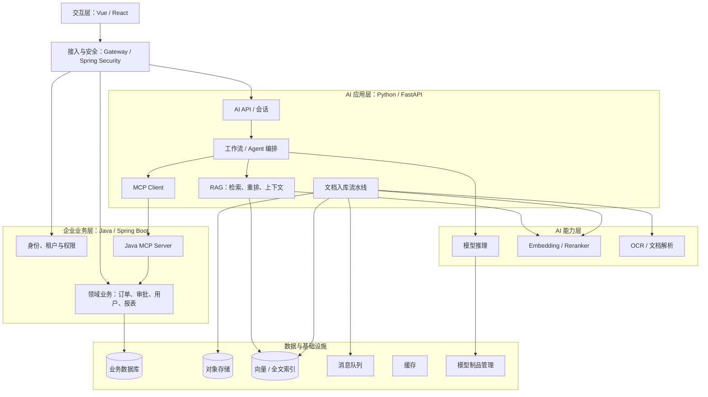
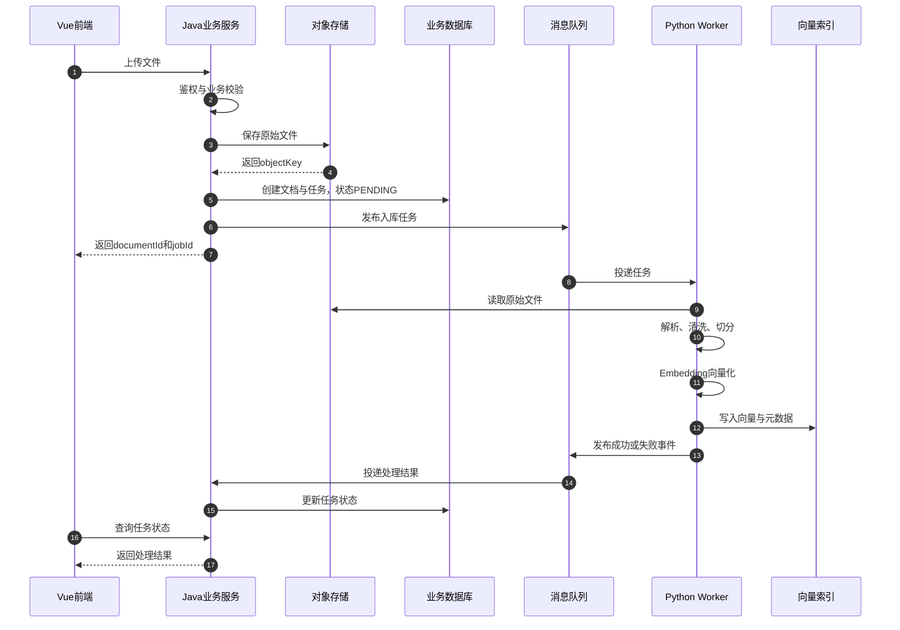
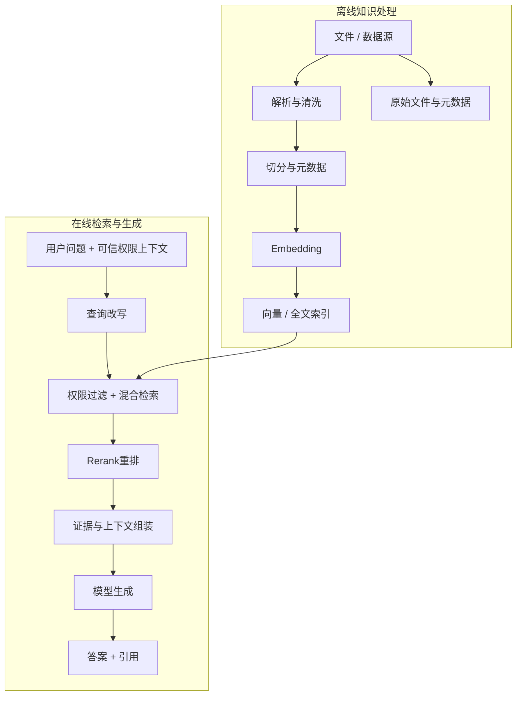
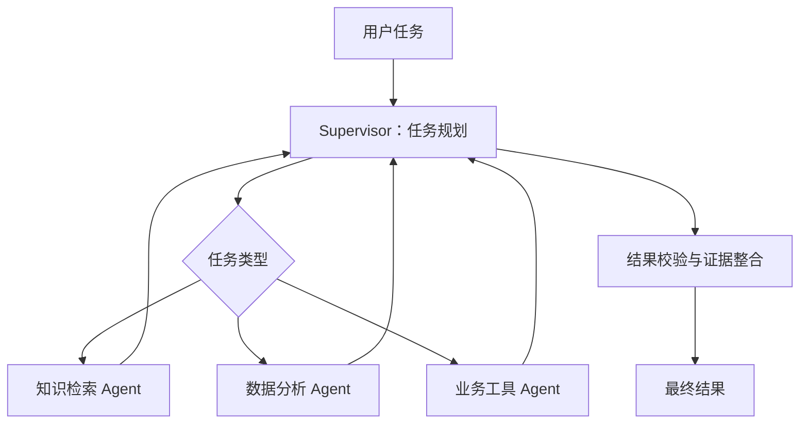
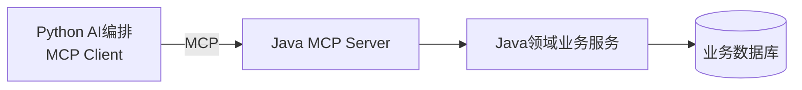
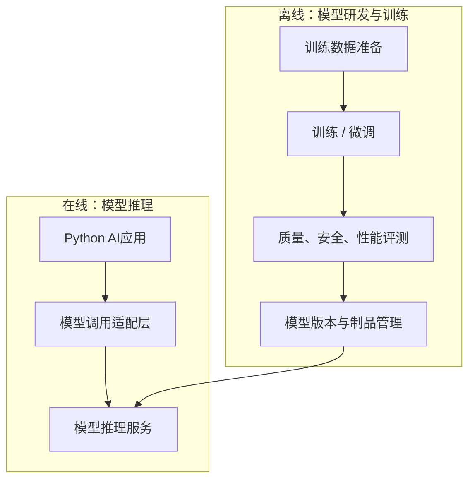
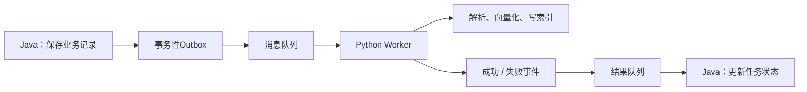
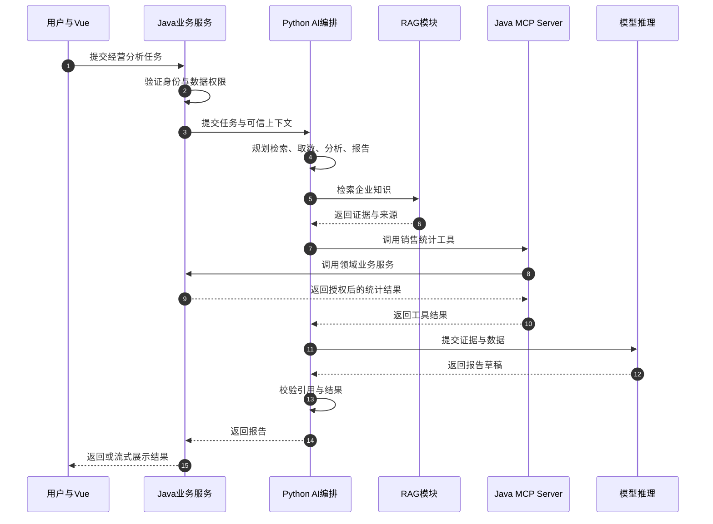

# AI业务应用架构设计

> 本文面向使用 Vue / React、Java、Python 和大模型技术构建企业级 AI 应用的场景，重点梳理系统分层、服务职责、RAG、多智能体、MCP、模型训练与部署、Java/Python 交互方式，以及安全、可靠性和运维治理。
>
> **核心结论：Java 负责企业业务和安全边界，Python 负责 AI 应用能力与模型处理；RAG 是知识增强能力，多智能体是任务编排方式，MCP 是 AI 应用连接工具的协议。服务如何拆分，应由业务边界、部署需求和运行特征决定，而不是一项技术对应一个微服务。**

---

## 目录

1. [设计目标与核心思想](#1-设计目标与核心思想)
2. [整体架构全景](#2-整体架构全景)
3. [各层职责与技术边界](#3-各层职责与技术边界)
4. [服务拆分的原则](#4-服务拆分的原则)
5. [文件上传与 RAG 入库流程](#5-文件上传与-rag-入库流程)
6. [RAG 在系统中的位置](#6-rag-在系统中的位置)
7. [多智能体在系统中的位置](#7-多智能体在系统中的位置)
8. [MCP 的作用与边界](#8-mcp-的作用与边界)
9. [模型微调、部署与在线推理](#9-模型微调部署与在线推理)
10. [Java 与 Python 的交互方式](#10-java-与-python-的交互方式)
11. [Spring AI 还是普通 Spring Boot](#11-spring-ai-还是普通-spring-boot)
12. [数据与存储设计](#12-数据与存储设计)
13. [安全、可靠性与系统治理](#13-安全可靠性与系统治理)
14. [推荐落地路线](#14-推荐落地路线)
15. [端到端示例：企业经营分析](#15-端到端示例企业经营分析)
16. [架构设计检查清单](#16-架构设计检查清单)

---

## 1. 设计目标与核心思想

企业级 AI 系统不是简单地在现有后端增加一个大模型 API。它需要把传统业务系统的确定性、权限边界与 AI 系统的推理、检索和任务规划能力组合起来。

### 1.1 先按职责划分，再选择技术

设计时先回答以下问题：

- 谁负责用户身份、企业业务规则、事务与数据权限？
- 谁负责读取和处理知识文档、检索内容、组织模型上下文？
- 谁负责规划复杂任务、选择工具、协调多个步骤？
- 谁负责模型训练、评测、版本发布和在线推理？
- 各服务如何通信，任务失败时如何重试、追踪和恢复？

先确定这些边界，再决定采用 Spring Boot、FastAPI、消息队列、向量数据库或 Agent 框架。

### 1.2 核心设计原则

1. **业务核心稳定，AI 能力可替换。** 用户、订单、审批、权限和业务规则不应绑定某个模型或 Agent 框架。将模型替换为另一个服务时，尽量不影响核心业务。
2. **身份和权限由可信后端掌握。** 模型可以建议调用工具，但不能自行决定用户是否有权访问数据或执行操作。最终权限必须由 Java 业务服务或实际的数据访问层校验。
3. **RAG、Agent、MCP 不属于同一个分类维度。** RAG 解决知识检索增强，Agent 解决任务规划与工具选择，MCP 解决 AI 应用与工具/资源之间的标准化连接。
4. **逻辑分层不等于物理拆服务。** 架构图中的每一层是职责边界，不代表每一层都必须独立部署。初期可以用模块化单体或少量服务，随着运行负载和组织协作需求增长再拆分。
5. **短请求同步，长任务异步。** 登录、查询状态等操作可以同步完成；文档解析、OCR、批量向量化、模型微调等长耗时任务应采用异步任务模式。
6. **先用简单可控的方案，再增加自主性。** 从常规模型调用、RAG 和确定性工作流开始；在确实需要模型自主规划、动态选工具或多角色协作时，再引入单智能体或多智能体。
7. **生产能力与模型能力同等重要。** 权限、可观测性、限流、幂等、评测、版本管理、数据治理和故障恢复都是架构的一部分，不是最后才考虑的附加功能。

---

## 2. 整体架构全景

下面是建议采用的逻辑架构。它表达的是职责与依赖关系，不是要求所有方框都单独部署。



### 横向贯穿所有层的治理能力

- **安全治理：** 身份认证、授权、租户隔离、密钥管理、数据脱敏、工具白名单。
- **可靠性治理：** 超时、重试、限流、熔断、幂等、任务补偿、死信队列。
- **可观测性：** 结构化日志、指标、分布式链路追踪、模型与检索调用记录。
- **AI 质量治理：** RAG 评测、模型评测、提示词版本、工具调用成功率、结果引用与人工审核。
- **成本治理：** Token 用量、GPU 利用率、缓存命中率、模型路由和任务预算。

---

## 3. 各层职责与技术边界

| 层 / 模块      | 推荐技术                               | 主要职责                                 | 不应承担的职责                      |
| ----------- | ---------------------------------- | ------------------------------------ | ---------------------------- |
| 前端交互层       | Vue / React                        | 上传文件、会话交互、流式展示、任务状态、管理界面             | 不直接保存模型密钥，不绕过后端访问内部数据库或模型服务  |
| 接入与认证层      | API Gateway、Spring Security        | 身份认证、访问控制、限流、请求路由、基础防护               | 不承担复杂的模型推理或长耗时文档处理           |
| 企业业务层       | Java、Spring Boot                   | 业务规则、事务、用户与租户、业务数据读写、业务状态、审计         | 不必承载所有 Python 模型处理细节         |
| AI 应用层      | Python、FastAPI                     | AI 请求入口、RAG、工作流、Agent、提示词、模型路由、上下文管理 | 不重新实现一套与 Java 冲突的企业业务真相和权限体系 |
| 文档处理 Worker | Python                             | 文档解析、OCR、清洗、切分、向量化、索引更新              | 不管理原始业务文件的最终所有权和业务授权规则       |
| MCP Server  | Java 或 Python                      | 将经过约束的业务能力或 AI 能力封装为工具               | 不以“工具描述写了权限要求”代替真实鉴权         |
| 模型训练流水线     | Python、PyTorch、Transformers 等      | 数据准备、微调、训练、评测、模型制品管理                 | 不与在线请求共用一个长时间运行的训练进程         |
| 模型推理服务      | 根据模型与硬件选择                          | 加载模型、在线生成、Embedding、重排、批处理和资源管理      | 不应直接管理企业业务事务                 |
| 数据与基础设施     | PostgreSQL / MySQL、对象存储、向量索引、消息队列等 | 持久化、检索、缓存、任务解耦和资源管理                  | 不因“企业级”而无差别引入所有基础设施          |

### 3.1 Java 的边界

Java 应当是企业业务规则的主要承载者。比如用户是否可以查看某部门的销售数据、订单是否允许取消、审批是否满足流转条件，应由 Java 业务服务执行判断。模型输出只能作为业务请求或建议，不能直接代替业务规则。

### 3.2 Python 的边界

Python 负责 AI 专属处理，例如文档解析、向量化、RAG 流程、Agent 编排和模型服务适配。它可以读取业务服务授权提供的数据，但不应通过另一套未受控的数据访问路径绕过 Java 的权限体系。

### 3.3 “一个模块”不一定是“一个服务”

例如，RAG 初期完全可以是 Python AI 服务中的一个 `rag` 模块；只有在被多个应用共用、需要独立扩缩容或维护节奏明显不同时，才考虑拆成独立 RAG 服务。

---

## 4. 服务拆分的原则

不要按“Java 一个服务、Python 一个服务、RAG 一个服务、Agent 一个服务、MCP 一个服务”的方式机械拆分。优先按业务领域和职责边界设计模块，再根据实际需求决定部署边界。

### 4.1 什么时候适合拆成独立服务？

满足以下一项或多项时，可以考虑拆分：

- 需要独立扩缩容。例如文档入库需要大量 CPU/GPU，而业务 API 主要需要低延迟。
- 需要独立发布、回滚或维护。例如模型推理引擎升级不应影响企业业务服务。
- 运行特征差异明显。例如文件解析是长任务，用户查询是短请求。
- 需要不同的资源或安全边界。例如 GPU 推理节点与普通业务节点分开部署。
- 多个业务系统需要复用同一项能力，例如统一知识检索服务。
- 团队职责和交付节奏已经形成稳定边界。

### 4.2 什么时候先不要拆？

- 只有一个 AI 应用，RAG 只被该应用使用。
- 服务间调用复杂度已经超过独立部署带来的收益。
- 模块仍在快速变动，边界尚未稳定。
- 暂时没有独立扩缩容、独立发布或团队协作的实际需求。

**建议：先用模块化单体或少量服务，把代码边界和 API 契约设计清楚；出现明确的运行和组织需求后，再拆服务。**

---

## 5. 文件上传与 RAG 入库流程

文件处理是最能体现 Java 与 Python 如何分工的场景。

### 5.1 推荐的职责分工

- **Vue：** 将文件上传到 Java，显示任务状态和处理结果。
- **Java：** 鉴权、文件格式与大小校验、知识库权限校验、保存原始文件、登记文件元数据、创建处理任务、管理业务状态。
- **对象存储：** 保存原始文件，例如 MinIO 或兼容 S3 的存储。
- **Python：** 读取原始文件，执行解析、OCR、清洗、切分、Embedding 与索引写入。
- **向量 / 全文索引：** 存储分块内容、向量及检索所需元数据。
- **消息队列（可选但适合生产场景）：** 解耦任务提交与实际处理，负责异步调度和积压缓冲。

### 5.2 文件入库时序图



### 5.3 为什么不建议在上传请求里等待全部处理完成？

文档解析、OCR、Embedding 和索引写入都可能耗时，批量文件更容易造成请求超时、线程被占用和重试放大。因此，应把“接收上传”和“处理文档”拆成两个阶段：

1. Java 完成原始文件保存和任务登记后，向前端返回文档 ID 与任务 ID。
2. Python 在后台异步完成处理，Java 维护任务状态，前端查询状态或接收状态推送。

### 5.4 Java 是调用 Python，还是让 Python 自己处理？

两种方案并不矛盾。关键是把 **触发任务** 与 **执行任务** 分开。

- 简单第一版：Java 通过 HTTP 调用 Python 的任务提交接口，Python 立即返回 `202 Accepted` 和 `jobId`，后台 Worker 再处理。
- 更适合长期运行的企业方案：Java 创建业务任务并发布消息，Python Worker 消费消息执行处理。
- 文件内容本身：通过对象存储共享，不建议把大型文件 Base64 编码后塞进任务 JSON。

任务消息通常只包含必要的引用和上下文，例如：

```json
{
  "eventId": "evt_001",
  "jobId": "job_90001",
  "documentId": "doc_10001",
  "knowledgeBaseId": "kb_001",
  "tenantId": "tenant_001",
  "objectKey": "tenant_001/kb_001/doc_10001.pdf",
  "documentVersion": 1
}
```

不要将用户提交的原始 `tenantId` 或 `userId` 当作自动可信的权限证明。消息应来自受信任的服务，消费者仍要校验任务来源、文档状态和授权上下文。

### 5.5 文档状态与幂等

建议至少定义：

`PENDING → PROCESSING → SUCCEEDED / FAILED`

需要时增加 `RETRYING`、`CANCELLED`、`DELETING` 等状态。

为文档、任务、版本和分块建立稳定的标识。相同任务因网络超时或消息重投而重复执行时，不能无控制地写入重复分块。可以使用幂等键、唯一约束、版本覆盖策略和任务执行记录控制重复执行。

如果数据库提交和消息发布必须保持一致，可采用事务性 Outbox：业务事务中同时写入业务记录和 Outbox 事件，由独立发布器把事件发送到消息队列，降低“数据库已提交但消息没有发出”的风险。

---

## 6. RAG 在系统中的位置

RAG（检索增强生成）是 AI 应用的知识增强能力。它可以作为 Python AI 应用内部的模块，也可以在有共享和扩缩容需求时独立成服务。RAG 不必在一开始就单独部署。

### 6.1 RAG 有两条链路：离线入库与在线检索



### 6.2 离线入库的主要组件

1. **文件解析：** 根据 PDF、Word、Markdown、HTML、图片等格式选择不同解析器。
2. **内容清洗：** 处理页眉页脚、重复内容、乱码、空白和不必要的格式噪声。
3. **表格与图片处理：** 对表格保留行列结构；需要理解图片内容时，可采用 OCR、图像描述或多模态模型。
4. **文本切分：** 根据段落、标题、Token 长度和语义结构确定 Chunk，不应所有文档使用完全相同的切分规则。
5. **元数据管理：** 保存 `documentId`、`chunkId`、来源、页码、版本、更新时间、租户和权限过滤字段。
6. **向量化与建索引：** 生成 Embedding，并按检索需求写入向量索引、全文索引或混合检索系统。
7. **更新与删除：** 明确版本更新、增量重建、过期索引清理和删除传播策略。

### 6.3 在线检索的主要组件

1. 接收用户问题和可信的身份、租户、权限上下文。
2. 根据需要进行查询改写、关键词扩展或查询分类。
3. 执行权限过滤、向量检索和/或全文检索。
4. 对候选结果进行去重、融合和重排（Rerank）。
5. 选择与问题相关的内容，构建模型上下文。
6. 生成答案，并尽可能返回可追溯的来源、页码或文档链接。
7. 记录检索结果和评测信息，以持续改善召回率和准确性。

### 6.4 RAG 的服务部署选择

| 方案        | 设计                      | 适用情况                      |
| --------- | ----------------------- | ------------------------- |
| 模块化 RAG   | RAG 作为 Python AI 服务内部模块 | 初期开发、单一 AI 应用、规模尚小        |
| 独立 RAG 服务 | 通过 API 为多个 AI 应用提供检索能力  | 多应用复用、独立扩缩容、检索资源与应用资源差异明显 |

建议先将 RAG 设计成结构清晰、接口明确的模块，再根据实际需求拆分。

### 6.5 RAG 的数据权限与提示注入防护

- 文档入库时保存其租户、知识库、来源和授权元数据。
- 在线检索时依据可信的身份与权限上下文过滤候选文档，不能只在模型提示词中要求“不要泄露”。
- 用户输入、检索到的文档内容和系统指令应区分处理。检索文档是数据，不是可信的系统命令。
- 模型生成答案后仍需控制引用与敏感信息输出，必要时使用脱敏、结果过滤和审计。
- 文档权限变更、用户离职、知识库删除或文档撤回时，应定义索引更新和缓存失效策略。

---

## 7. 多智能体在系统中的位置

多智能体（Multi-Agent）属于 AI 应用层的任务编排能力。它用于复杂任务的规划、拆分、执行、协调和结果整合，不应取代 Java 业务层。

### 7.1 应按复杂程度逐步引入

| 阶段           | 处理方式             | 常见场景            |
| ------------ | ---------------- | --------------- |
| 1. 普通 LLM 应用 | 输入 → 模型 → 输出     | 对话、摘要、格式转换      |
| 2. RAG       | 问题 → 检索知识 → 模型回答 | 企业知识问答、制度查询     |
| 3. 确定性工作流    | 按固定步骤执行工具        | 报表生成、固定审批辅助流程   |
| 4. 单智能体      | 模型根据任务选择工具并迭代执行  | 多步骤信息收集、动态工具选择  |
| 5. 多智能体      | 多个职责不同的 Agent 协作 | 跨领域研究、复杂分析、并行任务 |

固定、可预测的流程优先采用工作流。只有在确实需要动态规划、工具选择、复杂角色协作或并行任务时，再引入多智能体。多智能体通常会增加延迟、成本、状态管理与故障排查复杂度。

### 7.2 多智能体典型结构



- **Supervisor：** 意图分析，识别目标、规划步骤、选择 Agent、判断是否需要继续执行。
- **知识检索 Agent：** 通过 RAG 查找资料，并给出有来源依据的结果。
- **数据分析 Agent：** 调用受控的数据查询和计算工具。
- **业务工具 Agent：** 通过内部 API 或 MCP 调用经过授权的业务操作。
- **结果校验：** 检查证据、引用、结构、业务规则和输出要求。

初期这些 Agent 可以只是同一个 Python 服务中的不同模块或工作流节点，不必一开始部署成多个服务，也不必每个 Agent 配置独立模型。

### 7.3 Agent 的权限边界

Agent 的任务规划不等同于业务授权。即使 Agent 判断应该创建审批、删除文件或执行订单操作，工具服务也必须重新验证权限、参数和业务状态。对付款、删除、审批通过等高风险动作，应采用显式授权、人工确认、操作审计和必要的幂等控制。

---

## 8. MCP 的作用与边界

MCP（Model Context Protocol）用于标准化 AI 应用与工具、资源等能力之间的交互。它不是鉴权机制，也不是一种 Agent 架构，更不是 RAG 的替代方案。

### 8.1 推荐的 Java MCP 调用链



例如，可以将以下能力暴露为工具：

- `get_order_status`
- `get_sales_summary`
- `get_department_info`
- `create_approval_request`

这些工具在内部仍应调用常规 Java 领域服务。AI 不应直接获得数据库管理员账号，也不应绕过业务服务直接修改表数据。

### 8.2 哪些能力适合暴露为 MCP Tool？

- 多个 AI 应用可能复用的业务工具。
- 需要以统一协议向不同 Agent 或 AI Host 暴露的工具。
- 有明确输入参数、输出结构、权限模型和审计要求的能力。

如果 RAG 只服务于同一个 Python 应用，直接调用内部模块或 HTTP API 往往更简单；需要跨应用复用时，再将检索能力封装成 MCP Tool，例如 `search_knowledge_base`。

### 8.3 MCP 不自动解决的事情

- 用户是否登录、身份是谁。
- 用户是否有权查询某个部门或租户的数据。
- 某个工具是否允许执行写操作。
- 工具调用的速率、幂等、审计、审批和数据脱敏。

这些能力仍需由调用方、MCP Server 和最终业务服务按职责共同完成。工具描述可以辅助模型理解如何调用工具，但不能取代服务器端权限校验。

---

## 9. 模型微调、部署与在线推理

模型训练与模型在线服务应当分开设计。微调是离线研发流水线，推理是在线服务能力；二者通过经过评测和版本管理的模型制品连接。



### 9.1 什么时候使用 RAG，什么时候微调？

| 目标                 | 优先考虑            | 原因                      |
| ------------------ | --------------- | ----------------------- |
| 让模型回答企业内部最新知识      | RAG             | 可通过更新文档和索引更新知识，无需每次重新训练 |
| 让输出格式更稳定、某类任务行为更一致 | 提示词、结构化输出；必要时微调 | 先尝试成本更低、迭代更快的方法         |
| 让应用按不同任务选择工具、规划步骤  | 工作流 / Agent     | 这是应用编排问题，不一定需要微调        |
| 改善特定领域或任务的模型表现     | 数据质量与评测先行，再评估微调 | 微调效果取决于数据、目标和评测设计       |

RAG 和微调可以组合使用，但它们解决的问题不同。RAG 主要补充任务所需的外部知识；微调主要改变模型在特定任务上的行为或能力表现。

### 9.2 模型服务应有统一调用接口

Python AI 应用可以对底层模型做统一适配，例如：

- `chat()`：文本生成与对话。
- `embed()`：生成向量。
- `rerank()`：对候选文档重排。
- `multimodal()`：按需处理图像、音频或其他模态。

底层可以连接本地模型、独立推理服务器或外部模型 API。统一适配层有利于模型替换、版本切换、超时重试、成本统计和 A/B 评测。

---

## 10. Java 与 Python 的交互方式

Java 和 Python 之间没有唯一的“正确通信协议”。要根据请求时长、可靠性、流量和调用方式选择。常见的组合是：HTTP 负责同步操作与任务提交，消息队列负责长耗时异步任务，对象存储负责文件传递。

### 10.1 三类核心交互方式

| 方式          | 典型用途                      | 优点                  | 注意事项                       |
| ----------- | ------------------------- | ------------------- | -------------------------- |
| HTTP / REST | 提交任务、查询状态、普通 AI 请求、短时同步操作 | 简单、易调试、接口清晰         | 要设置超时、认证、错误处理和幂等策略         |
| 消息队列        | 文档入库、批量处理、重试、异步事件         | 降低服务耦合、削峰填谷、便于重试与扩展 | 要管理重复消息、死信队列、事件版本和任务状态     |
| 共享对象存储      | Java 保存原始文件、Python 根据引用读取 | 不必反复传输大文件，便于重处理     | 需处理最小权限、短期访问凭证、文件生命周期和删除策略 |

gRPC 也可以用于对延迟或吞吐有明确要求的内部服务通信，但它不是第一版的必选项。对初期系统而言，HTTP + 对象存储通常已经足够；需要可靠异步执行时，再增加消息队列。

### 10.2 HTTP 同步调用与异步任务提交的区别

对于轻量请求，例如查询模型健康状态或短时生成，可以同步请求并等待结果。

对于文档入库，建议使用“提交任务”的接口：

```http
POST /internal/v1/ingestion-jobs
Content-Type: application/json
Authorization: Bearer <service-token>
```

示例请求：

```json
{
  "documentId": "doc_10001",
  "knowledgeBaseId": "kb_001",
  "tenantId": "tenant_001",
  "objectKey": "tenant_001/kb_001/doc_10001.pdf",
  "documentVersion": 1
}
```

接口返回：

```http
HTTP/1.1 202 Accepted
```

```json
{
  "jobId": "job_90001",
  "status": "QUEUED"
}
```

Python 在后台执行处理。Java 可以通过结果事件更新业务状态，也可以由 Python 调用受保护的 Java 内部回调接口。前端则通过 Java 查询任务状态，避免直接依赖 Python Worker 的内部状态。

### 10.3 消息队列模式

如果文档任务对可靠性、积压管理、重试和并发控制有较高要求，可采用以下结构：



在这种模式下：

- Java 发布的是任务引用、文档 ID、版本和必要的处理参数，不是文件二进制内容。
- Python Worker 负责实际执行任务，并对可重试错误和不可重试错误进行分类。
- 重试应有次数上限和退避策略；超限任务进入死信队列或失败任务列表。
- 业务数据库写入与事件发布的一致性，可以按要求使用事务性 Outbox、任务补偿或定期对账。
- 结果事件应带有 `eventId`、`jobId`、`documentId`、版本和状态，消费方按幂等方式处理。

### 10.4 服务接口设计建议

- 为内部 API 明确版本，例如 `/internal/v1/...`。
- 统一成功、失败、超时和参数错误的返回结构。
- 使用请求 ID / Trace ID 串联 Java、Python、消息队列和模型服务日志。
- 区分业务错误、可重试技术错误和不可重试错误。
- 使用内部身份认证、最小权限服务凭证或其他可信身份传递机制；不要仅以“请求来自内网”作为授权依据。
- 大文件通过对象存储引用传递；有时效的下载凭证应短期有效，并限制读取范围。

---

## 11. Spring AI 还是普通 Spring Boot

**如果 Java 主要负责企业业务，并通过 HTTP 或消息队列调用 Python，普通 Spring Boot 就足够了。** Spring AI 不是 Java 与 Python 通信的必需组件。

### 11.1 选型表

| Java 侧需要完成的事情                   | 是否需要 Spring AI | 建议                                   |
| ------------------------------- | -------------- | ------------------------------------ |
| 登录、鉴权、业务 CRUD、事务、数据权限           | 不需要            | Spring Boot + Spring Security        |
| 调用 Python FastAPI 接口            | 不需要            | `RestClient`、`WebClient` 或 OpenFeign |
| 向消息队列发布任务                       | 不需要            | 使用对应消息队列客户端或 Spring 集成               |
| Java 自己直接调用模型生成内容               | 可以考虑           | Spring AI 可统一模型接入方式                  |
| Java 自己实现 RAG、Embedding 或向量存储集成 | 可以考虑           | 视 Java AI 能力范围选择对应模块                 |
| Java 实现 MCP Server，暴露业务工具       | 可以考虑           | 结合 Spring AI 的 MCP 支持评估              |

### 11.2 普通 Spring Boot 通过 RestClient 调用 Python

配置示例：

```yaml
integration:
  ai-service:
    base-url: http://ai-service:8000
```

创建客户端：

```java
@Configuration
public class AiServiceConfig {

    @Bean
    RestClient aiRestClient(
            RestClient.Builder builder,
            @Value("${integration.ai-service.base-url}") String baseUrl) {
        return builder
                .baseUrl(baseUrl)
                .build();
    }
}
```

封装 Python 任务提交接口：

```java
@Service
public class DocumentIngestionClient {

    private final RestClient aiRestClient;

    public DocumentIngestionClient(RestClient aiRestClient) {
        this.aiRestClient = aiRestClient;
    }

    public IngestionJobResponse submit(IngestionJobRequest request) {
        return aiRestClient.post()
                .uri("/internal/v1/ingestion-jobs")
                .body(request)
                .retrieve()
                .body(IngestionJobResponse.class);
    }
}
```

其中 `IngestionJobRequest` 与 `IngestionJobResponse` 是项目中的 DTO。该示例只负责提交任务，不应把同步等待整个文件向量化的逻辑塞进这个方法。

生产环境仍需进一步配置连接和响应超时、服务身份认证、可控重试、幂等键、错误映射和调用日志。网络超时不代表远端一定没有接到请求，因此任务提交应能够识别重复请求。

### 11.3 推荐的框架原则

不要因为系统里使用了大模型，就要求所有 Java 服务都引入 Spring AI。应根据 Java 是否真正承担模型调用、RAG 或 MCP 能力来选型。如果 RAG、Agent 编排和模型调用主要由 Python 负责，Java 聚焦业务与安全边界通常更清晰。

---

## 12. 数据与存储设计

建议明确不同数据的“权威来源”和维护责任，避免多个服务都能随意修改同一份数据。

| 数据类型 | 推荐存放位置 | 主要维护方 | 关键设计点 |
|---|---|---|---|
| 用户、租户、权限、业务实体 | 关系型业务数据库 | Java 业务服务 | 事务、约束、权限和审计 |
| 原始文档、图片及附件 | 对象存储 | Java 管理业务元数据与生命周期 | 加密、权限、版本、保留与删除策略 |
| 文档元数据与处理状态 | 业务数据库或明确的文档元数据服务 | Java 为业务状态提供权威来源 | documentId、版本、任务状态、来源、授权字段 |
| Chunk 与向量 | 向量数据库 / 支持向量的关系型数据库 | Python 入库流水线维护索引 | chunkId、documentId、版本、权限过滤和去重 |
| 全文检索索引 | 关系型全文能力或专用搜索引擎 | 检索/入库服务 | 分词、相关性、同步与重建策略 |
| 任务事件与异步队列 | 消息队列 | 生产者与消费者共同遵守事件契约 | 重试、顺序、幂等、死信和事件版本 |
| 模型权重、适配器与配置 | 模型制品存储 / 模型注册表 | 模型研发与发布流程 | 版本、评测结果、来源、回滚与兼容性 |

### 12.1 数据关联的基本标识

文档入库至少需要考虑以下标识：

- `tenantId`：租户或组织边界。
- `knowledgeBaseId`：知识库标识。
- `documentId`：业务文档标识。
- `documentVersion`：文档版本。
- `jobId`：某次处理任务标识。
- `chunkId`：文档分块标识。
- `traceId`：贯穿一次请求或任务的链路标识。

文档版本更新后，应明确旧索引是立即删除、保留一段时间还是切换别名。检索时应避免混合使用不同版本产生的分块。

---

## 13. 安全、可靠性与系统治理

企业级架构与 Demo 的主要差别之一，是系统能否在错误、权限变化、并发和不确定的模型输出下保持可控。

### 13.1 身份、授权与租户隔离

- 前端凭证由可信后端验证，不允许仅凭客户端提交的角色或租户字段判断权限。
- Java 负责企业业务访问控制；Python 服务也应验证调用来源、接口权限和可信上下文。
- 内部服务采用服务身份认证和最小权限凭证；按需使用短期凭证、密钥轮换和机密管理。
- RAG 检索要应用数据授权过滤；MCP 工具在执行时也要验证调用者权限。
- 跨租户任务、文档和向量索引必须有清晰的隔离规则。

### 13.2 文档处理与异步任务可靠性

- 设置文件大小、格式、数量、解压后体积和处理时长限制。
- 将文件解析、OCR、Embedding 与索引写入放入可控的后台任务中。
- 设置连接超时、处理超时、重试次数上限和退避机制。
- 区分临时故障与永久错误；失败后保留经过脱敏的错误摘要和可重试信息。
- 通过幂等键、唯一约束和版本策略避免消息重复投递造成重复写入。
- 设计任务取消、失败重跑、文档删除、索引清理和定期对账机制。
- 对外部模型或下游服务设置限流、并发上限及熔断策略。

### 13.3 Agent 与工具治理

- 工具采用白名单和明确的参数 Schema，不向模型开放任意内部网络、任意 SQL 或任意系统命令。
- 对查询工具限制结果范围和数据敏感级别。
- 对写操作采用明确授权、幂等、审计和必要的人工确认。
- 限制 Agent 最大迭代次数、工具调用次数、执行时长和 Token / 成本预算。
- 把模型提供的参数当作不可信输入进行验证。
- 对 RAG 内容中的恶意指令或提示注入保持隔离，不让检索内容覆盖系统级安全约束。

### 13.4 可观测性与审计

建议记录并关联以下信息：

- 请求 ID、任务 ID、文档 ID、版本、Trace ID。
- Java API、Python API、消息队列、模型和检索服务的耗时及结果状态。
- RAG 检索策略、候选数量、重排结果的必要摘要和引用来源。
- 模型名称与版本、提示词版本、Token 用量、工具调用次数和异常信息。
- 业务工具调用者、工具名称、关键参数摘要、授权结果和审计结果。

日志需要遵守隐私与数据保留要求，不应无差别记录完整敏感文档、访问令牌或用户机密。可使用结构化日志、指标系统和分布式链路追踪定位请求跨服务失败的位置。

### 13.5 AI 质量与模型治理

- 建立代表性问题集，评测检索召回、答案正确性、引用正确性和拒答表现。
- 保存模型版本、提示词版本、Embedding 版本和索引版本之间的关联。
- 模型升级、提示词修改或切换 Embedding 模型时执行回归评测。
- 对高风险输出建立规则校验或人工审核流程。
- 监控模型调用成功率、延迟、成本、GPU 利用率和模型服务饱和情况。
- 设计降级方案：模型不可用时返回可解释错误、进入队列、切换备用模型或使用受限能力，而不是无限重试。

### 13.6 性能与成本治理

- 文档入库与在线问答分开扩缩容，避免批量处理挤占在线推理资源。
- 根据实际负载决定是否引入缓存、批量 Embedding、异步队列和专用检索服务。
- 按任务类型选择不同模型或推理配置，避免所有请求都调用高成本模型。
- 监控 Token、Embedding、重排、OCR、存储和 GPU 等主要成本项。
- 通过并发限制和排队控制防止突发流量导致下游模型或数据库过载。

---

## 14. 推荐落地路线

建议按阶段建设，不必一开始就引入微服务集群、多智能体、消息队列和专用向量数据库的全部组合。

### 阶段一：建立业务与服务边界

1. 定义用户、租户、角色、数据权限及核心业务实体。
2. 使用 Spring Boot + Spring Security 实现鉴权、业务 API 和业务数据访问。
3. 明确 Java 业务服务是关键业务规则与事务的权威执行方。
4. 用 Python FastAPI 建立受保护的内部 AI API。
5. 定义 Java/Python 的请求 DTO、错误结构、超时、鉴权和日志规范。

### 阶段二：实现可靠的文件上传与 RAG

1. Java 保存原始文件到对象存储并登记元数据。
2. 先用 HTTP 提交 Python 异步入库任务，返回 `jobId`。
3. Python 完成解析、切分、Embedding、索引写入。
4. 实现文档状态、错误可见性、重试和幂等。
5. 做好检索权限过滤、来源引用、更新与删除策略。
6. 用真实问题集评测 RAG，而不只通过“能回答问题”判断效果。

### 阶段三：引入异步任务基础设施

1. 当任务量、重试要求或请求稳定性需要时，引入 RabbitMQ、Kafka 或其他适合的消息队列。
2. 设计任务事件版本、幂等键、失败重试和死信队列。
3. 按实际要求采用事务性 Outbox 和周期性对账。
4. 将文档入库 Worker 与在线 API 分开部署、独立扩缩容。

### 阶段四：接入业务工具与 MCP

1. 先从只读工具开始，如查询订单、查询销售汇总。
2. 将工具实现委托给 Java 领域业务服务，不直接操作底层数据库。
3. 增加工具参数校验、身份授权、速率限制和审计。
4. 当需要跨 AI 应用复用或统一工具协议时，再引入 MCP。
5. 对写操作逐步增加确认机制、幂等与补偿流程。

### 阶段五：增加工作流与多智能体

1. 对步骤清晰的任务采用确定性工作流。
2. 需要动态选择工具时，引入单智能体。
3. 只有在确实需要分工、并行或专门角色时，再引入多智能体。
4. 控制迭代上限、工具白名单、预算、失败恢复和人工审批。

### 阶段六：完善模型工程与生产治理

1. 建立训练数据管理、微调实验、模型评测和模型制品版本管理。
2. 使模型训练与在线推理分离。
3. 建立日志、指标、链路追踪和质量评测平台。
4. 增加密钥管理、限流、熔断、备份、恢复和安全检查。
5. 根据真实运行瓶颈决定是否拆分 RAG 服务、模型服务或引入更完整的编排平台。

---

## 15. 端到端示例：企业经营分析

假设用户提出：

> 分析上个月销售额下降的原因，并生成一份带数据依据的经营分析报告。

典型执行流程如下：



这里每个组件都只承担自己的职责：

- Java 决定用户可以查看哪些销售数据，并通过业务服务查询。
- RAG 提供与销售问题相关的企业知识和历史资料。
- Python 编排任务步骤，选择需要调用的检索与业务工具。
- MCP 提供标准化的工具连接方式，但不代替业务授权。
- 模型负责理解、推理和组织表达，但生成结论应尽可能有可追溯数据依据。

对于高风险业务操作，最后的结果或建议仍应经过规则校验和适当的人工确认，不应因 Agent 给出了结论就自动执行操作。

---

## 16. 架构设计检查清单

在进入开发或上线前，可以用以下问题检查设计是否完整。

### 业务与边界

- [ ] Java 是业务规则、事务和业务权限的权威执行方吗？
- [ ] Python 的 AI 能力是否通过明确的内部 API、任务事件或工具协议暴露？
- [ ] 服务拆分是基于职责和运行需要，而非单纯按技术名词拆分吗？

### 文件与 RAG

- [ ] 原始文件与生成的向量索引是否分开保存？
- [ ] 文件是否具有稳定的文档 ID、版本和来源信息？
- [ ] 入库任务是否有状态、幂等、重试和失败可见性？
- [ ] 检索是否依据可信权限上下文过滤文档？
- [ ] 更新、删除、权限变更和索引重建是否有明确流程？
- [ ] 答案是否能提供来源或引用，且引用可追溯？

### Java 与 Python 通信

- [ ] HTTP 请求是否有连接超时、响应超时和错误处理？
- [ ] 长耗时任务是否采用异步处理？
- [ ] 消息重投、网络超时与重复任务是否有幂等保护？
- [ ] 大文件是否通过对象存储引用传递，而不是被塞进任务消息？
- [ ] 服务身份认证、任务签名或可信授权上下文是否设计清楚？

### MCP 与 Agent

- [ ] MCP 工具是否有明确的输入、输出、权限和审计规则？
- [ ] 工具是否调用正式业务服务，而不是直接操作业务表？
- [ ] Agent 是否限制工具白名单、最大迭代次数、成本和执行时间？
- [ ] 高风险写操作是否有明确授权或人工确认？

### 生产治理

- [ ] 是否有结构化日志、Trace ID、指标和告警？
- [ ] 是否区分可重试错误与不可重试错误？
- [ ] 是否有死信、补偿、任务对账和故障恢复方案？
- [ ] 是否记录模型、提示词、Embedding 和索引版本？
- [ ] 是否建立 RAG 质量、模型质量、安全和成本评测？
- [ ] 敏感数据、令牌、文档内容和审计日志是否有适当保护？

---

## 总结

可以把整套架构归纳为四个核心问题：

| 核心问题 | 对应能力 |
|---|---|
| 谁可以使用系统、查看数据和执行操作？ | Java 身份认证、授权与业务安全 |
| 系统从哪里获取知识与事实？ | RAG、数据库、全文检索及其他数据源 |
| 系统如何规划并完成复杂任务？ | Python AI 编排、工作流、单智能体与多智能体 |
| 系统如何获得模型推理与生成能力？ | 模型推理服务，以及离线训练、微调和模型管理 |

MCP 是连接 AI 应用与工具、资源的一种协议；消息队列是处理异步任务的一种基础设施；对象存储用于保存和共享原始文件。它们分别解决不同的问题，不能相互替代。

对于初期实现，建议采用以下组合：

- **前端：** Vue / React。
- **企业业务：** Java + Spring Boot + Spring Security。
- **AI 应用：** Python + FastAPI。
- **服务交互：** 普通 HTTP API 起步；文档入库等长任务逐步采用消息队列。
- **文件：** 对象存储保存原始文件，Java 管理业务元数据与权限。
- **RAG：** 先作为 Python AI 服务内部模块，按需要再拆分。
- **工具连接：** 通过 Java 业务 API 或 MCP 暴露经过约束的业务能力。
- **Agent：** 先工作流、再单智能体，确有必要时才引入多智能体。
- **治理：** 从第一版就设计身份权限、任务幂等、可观测性、质量评测与成本控制。

**真正的企业级架构不是把所有技术都放进去，而是明确每个组件为什么存在、谁负责什么、如何协作、失败后如何恢复，以及如何在不推翻业务核心的前提下持续演进。**
