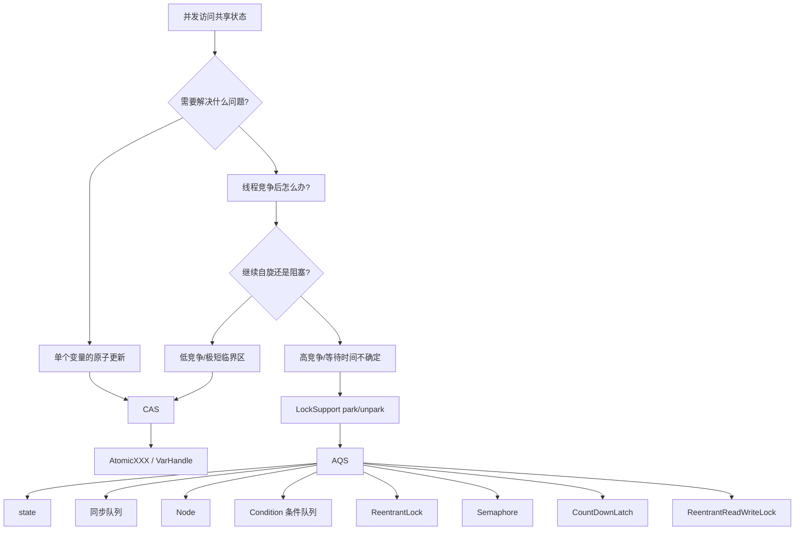
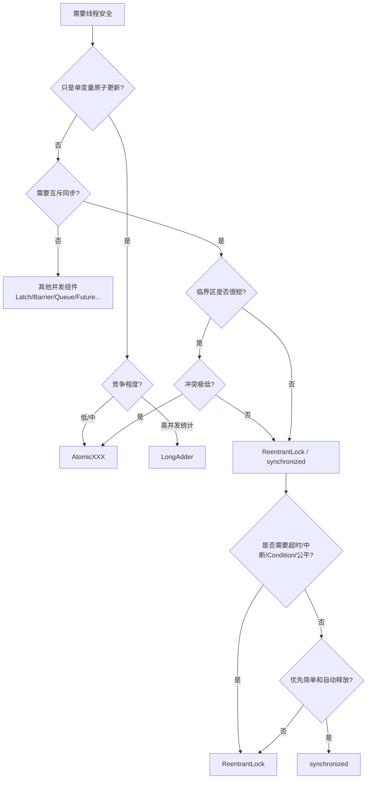

# CAS / AQS 深度解析与实战

> 主题：CAS、AQS、LockSupport（park/unpark）、Thread.join()、公平/非公平锁、无锁 vs 加锁选型  
> 适用：Java 8 ~ Java 21  
> 定位：从「会用」到「能讲清原理 + 能排错 + 能扛追问」
>
> **阅读方式：**
> 本文保留原文的核心内容和重点 Demo，但重新组织知识顺序，并补充 JMM、内存语义、取消机制、Condition 迁移、版本差异、工程陷阱等容易被遗漏的部分。
>
> **源码版本说明：**
> - 涉及 `waitStatus`、`acquireQueued()` 等经典源码时，以 **JDK 8** 代码作为学习主线；
> - 涉及现代实现时，额外说明 **JDK 21** 的源码结构变化；
> - 不把某一个 JDK 版本的 HotSpot 私有实现当成 Java 语言规范本身。

---

## 1. 先建立一张总图：为什么需要 CAS、LockSupport 和 AQS

很多人学习并发时容易把 CAS、AQS、LockSupport 当成三个平行知识点。

实际上，它们是一条逐层递进的链：



### 1.1 一句话理解三者关系

| 组件 | 本质 | 主要解决的问题 |
| --- | --- | --- |
| CAS | 原子读-改-写原语 | 多线程同时修改一个共享状态时，如何保证一次更新只有一个成功 |
| LockSupport | 线程阻塞/唤醒原语 | 线程竞争失败后，如何停止空转、等待条件满足 |
| AQS | 同步器框架 | 如何把 CAS、队列、阻塞/唤醒、取消、共享/独占等机制组织成可复用的同步器 |

因此：

> **CAS 解决“怎么原子地抢一次”；LockSupport 解决“抢不到之后怎么等”；AQS 解决“很多线程同时抢、等、醒、取消时，怎么把整个过程管理起来”。**

这也是理解全文最重要的一条主线。

---

## 2. 先补齐一个非常重要的基础：原子性、可见性、有序性不是一回事

并发问题经常被混成一句“线程安全”。

实际上至少需要区分：

| 能力 | 解决什么问题 | 典型手段 |
| --- | --- | --- |
| 原子性 | 操作是否能被并发线程“拆开” | CAS、锁 |
| 可见性 | 一个线程修改后，另一个线程能否看到 | `volatile`、锁、线程启动/终止规则 |
| 有序性 | 操作是否可能被重排序 | `volatile`、锁、happens-before 规则 |

### 2.1 `i++` 为什么不是原子操作

```java
i++;
```

逻辑上至少可以拆成：

```text
1. 读取 i
2. i + 1
3. 写回 i
```

两个线程可能同时读到 `100`：

```text
线程A：读 100
线程B：读 100

线程A：写 101
线程B：写 101
```

最终结果是 `101`，而不是 `102`。

因此：

> `volatile` 可以解决可见性，但不能把 `i++` 变成原子操作。

此时要么使用锁，要么使用 CAS 类原子更新。

### 2.2 CAS 为什么不仅仅是“原子”

以 `AtomicInteger.compareAndSet()` 为例，它不仅提供条件更新，还具有相应的内存语义。

JDK 21 的 `AtomicInteger.compareAndSet()` 明确规定，其内存效果遵循 `VarHandle.compareAndSet(...)`；普通 `get()` 对应 volatile 读取语义。

因此，理解原子类时不要只记：

> “AtomicInteger 就是不会丢更新。”

还应该理解：

> **原子更新 + 合适的内存语义，才能组成可靠的并发同步机制。**

---

## 3. CAS：最小粒度的乐观并发原语

### 3.1 什么是 CAS

CAS：

> Compare-And-Swap / Compare-And-Set

可以抽象成：

```text
V = 当前内存值
A = 期望值
B = 新值

if (V == A) {
    V = B;
    return true;
}
return false;
```

三个关键参数：

```text
V：内存中的当前值
A：线程认为应该存在的旧值
B：希望写入的新值
```

核心过程：

```text
读取当前值
    ↓
判断当前值 == 期望值？
    ↓
   是 ─────→ 写入新值并成功
    │
   否
    ↓
什么都不改并失败
```

CAS 的关键不是“交换”两个普通变量，而是：

> **比较 + 条件更新必须作为一个不可分割的原子动作完成。**

---

### 3.2 CPU 层的 CAS 到底是什么

在 Java 层看到的是：

```java
compareAndSet(expect, update)
```

但真正落到 CPU 时，会根据平台和 JVM 的实现映射到相应的原子指令序列。

#### 3.2.1 x86

典型指令为：

```text
lock cmpxchg
```

这里要特别修正一个常见说法：

> 不能简单理解为“`lock` 一定锁住整个总线”。

现代 x86 通常优先通过缓存一致性协议对相关缓存行实施原子化控制；只有特定情况下才可能退化到更重的总线级机制。

所以更准确的理解是：

> `lock` 提供强原子性保证，具体实现会利用缓存锁定/缓存一致性机制，而不是简单粗暴地理解为“锁住整条 CPU 总线”。

#### 3.2.2 ARM

不能再简单地写成：

> “ARM 没有 CAS，只能用 `LDREX/STREX`。”

现代 AArch64 平台已经存在专门的原子 CAS 类指令扩展（例如 LSE）；在不支持相关扩展的环境中，则可以使用 LL/SC 风格的原子序列。

因此：

> **ARM 的底层 CAS 实现与具体架构版本、CPU 特性以及 JVM 后端有关。**

本文只需要记住：

```text
Java CAS API
    ↓
JVM intrinsic / Unsafe / VarHandle
    ↓
目标 CPU 的原子读改写机制
```

不要把某一代 CPU 的汇编实现当成 Java 规范。

---

### 3.3 CAS 的经典自旋模型

CAS 最经典的上层使用方式：

```java
while (true) {
    int old = getCurrentValue();
    int next = old + 1;

    if (compareAndSet(old, next)) {
        return next;
    }

    // CAS 失败：
    // 说明当前值已经被其他线程修改
    // 重新读取，再尝试一次
}
```

为什么必须循环？

因为 CAS 的语义只是：

> “我认为当前值还是 old；如果真是 old，就修改成功。”

竞争下可能发生：

```text
线程A：读取 10
线程B：把 10 -> 11

线程A：CAS(10, 11)
结果：失败
```

失败并不代表程序异常。

> **CAS 失败本身就是并发竞争的一部分。**

---

### 3.4 CAS 与自旋：什么时候划算

CAS 的优势：

```text
不需要进入内核阻塞
没有锁队列
没有线程上下文切换
临界区很短时延迟低
```

但是它也有一个致命问题：

> **竞争失败的线程可能一直在 CPU 上运行。**

例如 100 个线程争抢一个变量：

```text
线程1 ─┐
线程2 ─┤
线程3 ─┤
...    ├──→ 同一个 CAS 热点
线程100┘
```

大量线程会不断：

```text
读 → 算 → CAS失败 → 再读 → 再算 → 再CAS
```

结果是：

```text
锁没加
但是 CPU 被吃掉了
```

所以：

> **“无锁”不等于“没有代价”。**

这也是为什么 AQS 不是简单地把 CAS 再套一层，而是要进一步解决“抢不到之后怎么办”。

---

### 3.5 CAS 的四类典型问题

原文主要覆盖了 ABA、自旋、单变量更新，这里再把它们和实际工程含义连起来。

| 问题 | 本质 | 常见解决方案 |
| --- | --- | --- |
| ABA | 值看起来没变，但中间已经变化过 | 版本戳、标记位、不可变状态对象 |
| 高竞争自旋 | CPU 持续空转 | `LongAdder`、退避、自旋转阻塞 |
| 多变量一致性 | CAS 只能直接原子更新某个共享状态 | `AtomicReference` + 不可变对象、事务式设计、锁 |
| 活锁/重试风暴 | 线程都在努力，但整体进展很慢 | 限制重试、退避、队列化、锁 |

---

### 3.6 ABA：值相同，不代表状态没有变化

经典过程：

```text
线程A读取：A

线程B：
A → B
B → A

线程A：
CAS(A → C)
```

线程A 最后看到的仍然是 A，于是认为：

> “没有人动过。”

但实际上中间已经发生过：

```text
A → B → A
```

如果“中间发生过变化”本身有业务意义，那么 CAS 就可能做出错误判断。

#### 3.6.1 典型危险场景

链表/栈等无锁数据结构中，节点可能被弹出后又重新进入结构：

```text
栈顶：A
    ↓
A 被弹出
    ↓
压入 B
    ↓
A 又被压回
```

此时：

```text
值看起来又是 A
对象生命周期和拓扑关系却已经发生变化
```

可能导致错误的 CAS 成功、链表断裂甚至数据结构损坏。

---

### 3.7 ABA 的修复：版本戳

`AtomicStampedReference` 可以把：

```text
值
+
版本号
```

一起比较。

例如：

```text
初始：
(value=A, stamp=0)

第一次修改：
(value=B, stamp=1)

再次修改：
(value=A, stamp=2)
```

最后即使值恢复成 A：

```text
A + stamp 2
```

也不再等于最初：

```text
A + stamp 0
```

#### 3.7.1 Demo

```java
import java.util.concurrent.atomic.AtomicStampedReference;

public class AbaDemo {

    public static void main(String[] args) throws InterruptedException {
        AtomicStampedReference<Integer> ref =
                new AtomicStampedReference<>(100, 0);

        // 主线程记录“当时的值”和“当时的版本”
        Integer expectedValue = ref.getReference();
        int expectedStamp = ref.getStamp();

        Thread hacker = new Thread(() -> {
            int stamp1 = ref.getStamp();

            ref.compareAndSet(
                    ref.getReference(),
                    200,
                    stamp1,
                    stamp1 + 1
            );

            int stamp2 = ref.getStamp();

            ref.compareAndSet(
                    ref.getReference(),
                    100,
                    stamp2,
                    stamp2 + 1
            );
        }, "hacker");

        hacker.start();
        hacker.join();

        // 当前值可能已经重新变成 100，
        // 但版本已经不是最初的 0
        boolean success = ref.compareAndSet(
                expectedValue,
                300,
                expectedStamp,
                expectedStamp + 1
        );

        System.out.println("当前值 = " + ref.getReference());
        System.out.println("当前版本 = " + ref.getStamp());
        System.out.println("CAS 是否成功 = " + success);
    }
}
```

#### 3.7.2 一个容易踩的坑：引用比较

`AtomicReference` / `AtomicStampedReference` 对引用类型进行 CAS 时，本质上比较的是引用身份，而不是 `equals()`。

错误理解：

```java
new String("A")
```

与：

```java
new String("A")
```

虽然 `equals()` 为 `true`，但并不代表是同一个对象。

更稳妥的方式是：

> **把“期望对象”从原子引用本身读出来，再拿这个引用参与 CAS。**

例如：

```java
Integer expected = ref.getReference();

ref.compareAndSet(
        expected,
        newValue,
        oldStamp,
        newStamp
);
```

不要依赖 `Integer` 缓存范围去“碰运气”。

---

### 3.8 AtomicInteger 的源码模型

JDK 8 经典实现可以抽象成：

```java
public final int getAndAddInt(Object o, long offset, int delta) {
    int v;

    do {
        v = getIntVolatile(o, offset);
    } while (!compareAndSwapInt(o, offset, v, v + delta));

    return v;
}
```

核心只有四步：

```text
volatile 读取
    ↓
计算新值
    ↓
CAS 尝试更新
    ↓
失败则重试
```

现代 JDK 的具体实现入口发生了变化，但核心思想没有变：

```text
读取 → 计算 → CAS → 失败重试
```

JDK 9+ 之后，`VarHandle` 还进一步提供了 acquire/release/opaque 等更细粒度的内存访问语义。

---

### 3.9 CAS 的 Java 入口

| 层级 | API | 作用 |
| --- | --- | --- |
| 业务层 | `AtomicInteger` / `AtomicLong` / `AtomicReference` | 最常用 |
| JDK 内部 | `Unsafe` | JDK 内部底层能力 |
| 现代 API | `VarHandle` | JDK 9+，支持更细的内存访问模式 |

工程上：

> 优先使用 `AtomicXXX` 或 `VarHandle`，不要在业务代码中直接依赖内部 `Unsafe` API。

---

### 3.10 高竞争计数：为什么会出现 LongAdder

假设：

```text
AtomicLong
    |
    +--- 所有线程 CAS 同一个 value
```

如果线程很多：

```text
T1 ─┐
T2 ─┤
T3 ─┤
T4 ─┤
... ├──→ value
T100┘
```

CAS 热点非常集中。

`LongAdder` 的思路是：

```text
              base
               |
       ┌───────┼───────┐
       ↓       ↓       ↓
     Cell1   Cell2   Cell3 ...
```

低竞争时：

```text
直接更新 base
```

高竞争时：

```text
线程 → probe/hash → 不同 Cell
```

于是：

> **把一个热点拆成多个热点，使用空间换取并发吞吐。**

---

### 3.11 LongAdder 的关键点

#### 3.11.1 低竞争

```text
CAS(base)
```

#### 3.11.2 高竞争

```text
base + Cell1 + Cell2 + Cell3 + ...
```

#### 3.11.3 读取

```java
long total = adder.sum();
```

但是必须记住：

> `LongAdder.sum()` **不是原子快照**。

如果多个线程还在写：

```text
读取 Cell1
线程A修改 Cell2
读取 Cell2
线程B修改 Cell3
读取 Cell3
```

最终拿到的值可能没有包含所有并发更新。

所以：

#### 3.11.4 适合

```text
QPS
请求数
成功数
失败数
监控统计
Metrics
```

#### 3.11.5 不适合

```text
账户余额
精确库存
精确扣减
需要“读完后立即基于该值做决定”的同步控制
```

精确控制场景通常使用：

```text
AtomicLong
AtomicReference
锁
事务
```

而不是把 `LongAdder` 当成精确状态机。

---

### 3.12 LongAdder 与伪共享

多个 Cell 如果频繁写入相邻缓存行，可能发生：

```text
CPU Core 1 → 写 Cell1
CPU Core 2 → 写 Cell2
```

而 Cell1 与 Cell2 恰好处于同一缓存行时，一个核心的写入会导致另一个核心缓存行失效。

这就是：

> False Sharing，伪共享。

JDK 内部实现会针对 Cell 的布局做缓存行隔离，避免多个高频写变量互相干扰。

这里要注意：

> **64B 是常见缓存行大小，但不要把“64B”当成所有 CPU 的绝对规律。**

---

### 3.13 CAS Demo：基础计数

```java
import java.util.concurrent.atomic.AtomicInteger;

public class CasDemo {

    public static void main(String[] args) throws InterruptedException {
        AtomicInteger counter = new AtomicInteger(0);

        Runnable task = () -> {
            for (int i = 0; i < 5000; i++) {
                counter.incrementAndGet();
            }
        };

        Thread t1 = new Thread(task, "t1");
        Thread t2 = new Thread(task, "t2");

        t1.start();
        t2.start();

        // 主线程等待两个工作线程结束
        t1.join();
        t2.join();

        System.out.println("结果：" + counter.get());
    }
}
```

结果：

```text
10000
```

这里真正值得学习的不是 `10000`，而是：

```text
incrementAndGet()
    ↓
原子更新
    ↓
多个线程不会把更新互相覆盖
```

而 `join()` 负责解决的是：

```text
主线程什么时候可以安全读取最终结果？
```

这两个问题不要混为一谈。

---

## 4. 从“自旋”走向“阻塞”：为什么需要 LockSupport

CAS 很快，但 CAS 永远有一个问题：

> **线程抢不到资源时，总不能永远在 CPU 上空转。**

因此需要另一种策略：

```text
短暂竞争
    ↓
CAS 自旋可能更划算

竞争时间不可预测 / 竞争激烈
    ↓
把线程挂起
```

这就是 `LockSupport` 出现的意义。

---

### 4.1 LockSupport 的核心 API

```java
LockSupport.park();
LockSupport.unpark(thread);
```

可以简单理解成：

```text
park   = 当前线程先停下来
unpark = 给指定线程一个“可以继续”的机会
```

但真正需要记住的是：

> LockSupport 不是简单的 “block/unblock”；
> 它背后是每个线程关联一个最多为 1 的 permit（许可）。

---

### 4.2 permit 机制是理解 LockSupport 的关键

#### 4.2.1 规则 1：许可最多 1 个

连续：

```java
unpark(thread);
unpark(thread);
```

不会累加成 2 个 permit。

---

#### 4.2.2 规则 2：可以先 unpark，再 park

```java
LockSupport.unpark(t);
LockSupport.park();
```

如果许可已经可用：

```text
park()
    ↓
消费 permit
    ↓
立即返回
```

这避免了：

```text
notify() → wait()
```

之间那种经典的“通知丢失”窗口。

---

#### 4.2.3 规则 3：park 不要求 synchronized

```java
LockSupport.park();
```

不需要：

```java
synchronized
```

也不要求先持有某个 monitor。

因此 AQS 可以非常自由地把线程和同步队列组合起来。

---

### 4.3 park 不等于“永远睡眠”

`park()` 返回至少有几种可能：

```text
1. 被 unpark
2. 被 interrupt
3. 超时（针对 timed park）
4. 虚假返回
```

因此：

> **park 返回 ≠ 条件已经满足。**

必须重新检查条件。

经典模式：

```java
while (!canProceed()) {
    LockSupport.park(this);
}
```

这也是 AQS 为什么必须使用循环的重要原因。

---

### 4.4 park 的内存可见性也不能靠“感觉”

`park/unpark` 的正确使用应与：

```text
volatile / atomic state
```

等同步状态配合。

不要写成：

```java
boolean ready = false;
```

然后完全依赖：

```text
park/unpark
```

来“碰运气”完成数据可见性。

更稳妥的同步模型是：

```java
volatile boolean ready;

while (!ready) {
    LockSupport.park(this);
}
```

或者直接使用：

```text
AtomicXXX
Lock
Condition
BlockingQueue
CountDownLatch
```

等已有同步原语。

---

### 4.5 blocker：为什么生产代码推荐带 blocker

推荐：

```java
LockSupport.park(this);
```

而不是：

```java
LockSupport.park();
```

blocker 用来告诉诊断工具：

```text
线程到底在因为什么对象/同步器而等待？
```

例如：

```text
parking to wait for <某个同步器对象>
```

对于排查：

```text
大量 WAITING (parking)
```

非常有价值。

---

### 4.6 LockSupport Demo

```java
import java.util.concurrent.locks.LockSupport;

public class ParkDemo {

    static final Object BLOCKER = new Object();

    public static void main(String[] args) throws InterruptedException {

        Thread worker = new Thread(() -> {

            System.out.println("worker：准备 park");

            LockSupport.park(BLOCKER);

            System.out.println(
                    "worker：被唤醒，中断标志 = "
                            + Thread.currentThread().isInterrupted()
            );

        }, "worker");

        worker.start();

        Thread.sleep(2000);

        System.out.println("main：调用 unpark");

        LockSupport.unpark(worker);
    }
}
```

---

### 4.7 先 unpark 后 park Demo

```java
import java.util.concurrent.locks.LockSupport;

public class ParkPermitDemo {

    public static void main(String[] args) throws InterruptedException {

        Thread t = new Thread(() -> {

            // 先获得一个 permit
            LockSupport.unpark(Thread.currentThread());

            // 消费 permit，不阻塞
            LockSupport.park();

            System.out.println("park 未阻塞，permit 已生效");

        });

        t.start();
        t.join();
    }
}
```

---

### 4.8 `park`、`wait`、`sleep`、`Condition.await` 对比

| 维度 | `Thread.sleep` | `Object.wait` | `LockSupport.park` | `Condition.await` |
| --- | --- | --- | --- | --- |
| 释放当前锁 | ❌ | ✅ 当前 monitor | 不涉及 monitor | ✅ 当前 Lock |
| 必须先持有锁 | ❌ | ✅ monitor | ❌ | ✅ 对应 Lock |
| 唤醒方式 | 时间到 / 中断 | `notify/notifyAll` / 中断 | `unpark` / 中断 / 虚假返回 | `signal/signalAll` / 中断 / 超时 |
| 先唤醒后等待 | — | 存在丢失通知问题 | ✅ permit 可保留 | 依赖 Condition 的同步使用模式，不能照搬 `unpark` 的 permit 语义 |
| 能否精确指定线程 | — | ❌ `notify` 不保证指定线程 | ✅ `unpark(thread)` | ❌ 通过 Condition 的等待队列管理 |
| 中断行为 | 抛 `InterruptedException` | 抛 `InterruptedException` | 返回，不自动抛异常 | 通常抛 `InterruptedException` |
| 典型状态 | `TIMED_WAITING` | `WAITING/TIMED_WAITING` | `WAITING/TIMED_WAITING` | `WAITING/TIMED_WAITING` |

---

## 5. AQS：把 CAS、自旋、队列、阻塞组织起来

现在已经知道：

```text
CAS：
解决原子更新

LockSupport：
解决阻塞/唤醒

但还有一个问题：
几十个线程都在抢一个锁时，谁排队？
谁该被唤醒？
取消怎么办？
超时怎么办？
共享锁怎么办？
条件变量怎么办？
```

这就是 AQS。

---

### 5.1 AQS 是什么

`AbstractQueuedSynchronizer`：

> **Java 并发包中的同步器模板框架，本身不是一个具体锁。**

它主要负责：

```text
排队
阻塞
唤醒
取消
共享/独占模式
状态管理
```

子类只需要定义：

```text
什么叫“获取成功”
什么叫“释放成功”
```

剩下的机械工作由 AQS 处理。

---

### 5.2 AQS 的三大核心

#### 5.2.1 `state`

同步器状态。

在经典 JDK 8 AQS 中：

```java
private volatile int state;
```

它的含义由子类定义。

例如：

| 同步器 | state 的典型含义 |
| --- | --- |
| `ReentrantLock` | 0=未持有；正数=重入次数 |
| `Semaphore` | 剩余许可数 |
| `CountDownLatch` | 剩余计数 |
| `ReentrantReadWriteLock` | 高/低位拆分读写持有状态 |

---

#### 5.2.2 同步队列

竞争失败的线程不会无限 CAS。

而是：

```text
线程
 ↓
Node
 ↓
加入同步队列
 ↓
等待前驱/释放者进行信号通知
```

---

#### 5.2.3 模板方法

独占模式：

```java
tryAcquire(int arg)
tryRelease(int arg)
```

共享模式：

```java
tryAcquireShared(int arg)
tryReleaseShared(int arg)
```

Condition 相关：

```java
isHeldExclusively()
```

---

### 5.3 为什么 AQS 使用 CLH 变体双向队列

AQS 的队列经常被叫做：

> CLH 队列的变体

但不能简单理解为“传统 CLH 自旋锁”。

AQS 在 CLH 思想之上增加了：

```text
prev
next
status / waitStatus
Thread
```

从而支持：

```text
阻塞
唤醒
取消
条件队列迁移
共享传播
```

---

### 5.4 Node：一个节点代表一个等待者

经典 JDK 8 结构：

```java
static final class Node {

    volatile int waitStatus;

    volatile Node prev;

    volatile Node next;

    volatile Thread thread;

    Node nextWaiter;
}
```

可以理解为：

```text
prev ← Node → next
         |
         └── thread
```

每个 Node 记录：

```text
我是谁
我排在谁后面
我后面是谁
我当前是否需要被唤醒
```

---

### 5.5 waitStatus：必须真正理解

JDK 8 经典状态：

| 状态 | 值 | 含义 |
| --- | ---: | --- |
| `CANCELLED` | 1 | 当前等待已经取消 |
| `SIGNAL` | -1 | 当前节点释放/取消时需要唤醒后继 |
| `CONDITION` | -2 | 当前节点位于 Condition 条件队列 |
| `PROPAGATE` | -3 | 共享模式下继续向后传播 |
| `0` | 0 | 默认/中性状态 |

特别强调：

#### 5.5.1 `SIGNAL` 的意思不是“我现在被唤醒”

而是：

> **“我的后继线程可能要去 park，我需要在释放时负责通知它。”**

这是很多人看源码时最容易读反的地方。

---

### 5.6 为什么是双向链表

#### 5.6.1 原因 1：取消节点时需要 `prev`

如果：

```text
A → B → C → D
```

B 取消：

```text
A → C → D
```

需要找到：

```text
A
```

然后跳过：

```text
B
```

---

#### 5.6.2 原因 2：取消导致 `next` 暂时不可靠

并发环境下，后继节点可能：

```text
取消
尚未完全建立 next
正在重新连接
```

释放锁时，需要有机会：

```text
从 tail 反向寻找最近的有效节点
```

这也是双向链表的重要价值。

---

#### 5.6.3 原因 3：等待前驱状态

AQS 的等待协议本身就是：

```text
后继关注前驱
前驱在释放/取消时负责通知后继
```

所以 `prev` 是核心关系。

---

### 5.7 AQS 的本质：不是“永远排队”，而是“抢锁 + 排队”

AQS 最核心的思想可以概括成：

```text
第一次先尝试获取
        ↓
成功 → 直接执行

失败
        ↓
进入队列
        ↓
短暂重试/检查
        ↓
仍然失败
        ↓
park
        ↓
被唤醒
        ↓
重新 tryAcquire
        ↓
成功 or 再次 park
```

因此：

> **AQS 不是纯自旋，也不是一失败就马上陷入阻塞。**

不同 JDK 版本还会加入一定的短暂自旋和退避策略。

---

## 6. ReentrantLock 获取锁：把整个 AQS 流程串起来

最值得掌握的调用链：

```text
lock()
  ↓
sync.acquire(1)
  ↓
tryAcquire(1)
  ↓
成功？
├─ 是 → 返回
└─ 否
     ↓
addWaiter()
     ↓
进入同步队列
     ↓
acquireQueued()
     ↓
前驱是 head？
├─ 是 → 再 tryAcquire()
└─ 否
     ↓
shouldParkAfterFailedAcquire()
     ↓
LockSupport.park()
     ↓
被唤醒
     ↓
重新 tryAcquire()
```

---

### 6.1 `acquireQueued()` 的经典源码

以下以 JDK 8 的经典实现作为学习重点：

```java
final boolean acquireQueued(final Node node, int arg) {
    boolean failed = true;

    try {
        boolean interrupted = false;

        for (;;) {

            final Node p = node.predecessor();

            // 前驱已经成为 head
            if (p == head && tryAcquire(arg)) {

                // 当前节点成为新的 head
                setHead(node);

                // 旧 head 不再需要 next
                p.next = null;

                failed = false;

                return interrupted;
            }

            // 检查是否应该 park
            if (shouldParkAfterFailedAcquire(p, node)
                    && parkAndCheckInterrupt()) {

                // acquire() 不支持可中断获取：
                // 中断只记录，不立即抛异常
                interrupted = true;
            }
        }

    } finally {
        if (failed) {
            cancelAcquire(node);
        }
    }
}
```

---

### 6.2 为什么“前驱是 head”才有资格再次抢

假设：

```text
head → A → B → C
```

当前 C：

```text
C 的前驱 = B
```

如果 A 还在等待：

```text
C 没必要越过 A/B 直接抢
```

所以队列中的正常获取路径是：

```text
只有排在队首附近的节点
才有资格参与下一次获取
```

但这里必须注意：

> **这并不意味着非公平锁严格 FIFO。**

因为非公平锁在调用 `tryAcquire()` 前还允许：

```text
队列外新来的线程
直接 CAS 抢锁
```

因此：

```text
AQS 有队列 ≠ ReentrantLock 就是公平锁
```

---

### 6.3 `shouldParkAfterFailedAcquire()` 的三个分支

经典 JDK 8 逻辑可以概括为：

```text
前驱 SIGNAL
    ↓
可以 park

前驱 CANCELLED
    ↓
向前跳过取消节点

前驱既不是 SIGNAL，也没有取消
    ↓
把前驱设为 SIGNAL
    ↓
本轮先不 park
    ↓
重新尝试
```

伪代码：

```java
int ws = pred.waitStatus;

if (ws == SIGNAL) {
    return true;
}

if (ws > 0) {
    // 跳过 CANCELLED
    do {
        node.prev = pred = pred.prev;
    } while (pred.waitStatus > 0);

    pred.next = node;

} else {
    // 把前驱变成 SIGNAL
    compareAndSetWaitStatus(pred, ws, Node.SIGNAL);
}

return false;
```

为什么设成 SIGNAL 后还不能立即 park？

因为：

```text
设置 SIGNAL
```

和：

```text
真正再次尝试抢锁
```

之间必须避免丢失释放信号的竞态。

AQS 的设计原则可以理解为：

> **先建立“有人需要通知”的协议，再真正进入阻塞。**

---

### 6.4 被 unpark 就一定拿到锁吗？

**不一定。**

这是理解 AQS 最重要的面试问题之一。

流程：

```text
锁释放
 ↓
unpark(线程A)
 ↓
线程A 从 park 返回
 ↓
进入 acquireQueued 循环
 ↓
tryAcquire()
```

此时可能：

```text
成功
```

也可能：

```text
失败
 ↓
再次 park
```

甚至非公平锁情况下：

```text
A 被唤醒
 ↓
新线程 B 刚好到达
 ↓
B 先 CAS 抢到锁
 ↓
A 再次等待
```

所以：

> **unpark 的语义是“允许你继续竞争”，不是“把锁直接交给你”。**

---

### 6.5 为什么 park 必须放在循环里

因为存在：

```text
虚假唤醒
```

同时：

```text
被唤醒 ≠ 条件成立
```

所以正确模式一定是：

```java
while (!condition) {
    LockSupport.park(this);
}
```

这与：

```java
while (!condition) {
    wait();
}
```

是同一种同步设计思想。

---

## 7. ReentrantLock 释放锁：从 unlock 到 unpark

调用链：

```text
unlock()
  ↓
sync.release(1)
  ↓
tryRelease(1)
  ↓
state 是否归零？
├─ 否 → 仍然重入，不唤醒后继
└─ 是
     ↓
清空 owner
     ↓
unparkSuccessor(head)
     ↓
LockSupport.unpark(后继)
```

经典 JDK 8 代码：

```java
public final boolean release(int arg) {

    if (tryRelease(arg)) {

        Node h = head;

        if (h != null && h.waitStatus != 0) {
            unparkSuccessor(h);
        }

        return true;
    }

    return false;
}
```

---

### 7.1 `unparkSuccessor()` 为什么可能从 tail 向前找

经典实现：

```java
private void unparkSuccessor(Node node) {

    int ws = node.waitStatus;

    if (ws < 0) {
        compareAndSetWaitStatus(node, ws, 0);
    }

    Node s = node.next;

    if (s == null || s.waitStatus > 0) {

        s = null;

        for (Node t = tail;
             t != null && t != node;
             t = t.prev) {

            if (t.waitStatus <= 0) {
                s = t;
            }
        }
    }

    if (s != null) {
        LockSupport.unpark(s.thread);
    }
}
```

这段代码再次体现：

```text
双向链表
=
next 用于快速访问
+
prev 用于在并发取消时恢复可用后继
```

---

### 7.2 重入是怎么实现的

`ReentrantLock` 的“可重入”其实非常朴素：

```text
state
+
owner
```

第一次获取：

```text
state = 0
   ↓
CAS(0, 1)
   ↓
owner = currentThread
```

同一线程再次获取：

```text
发现：
currentThread == owner
```

于是：

```text
state++
```

无需重新 CAS。

释放：

```text
state--
```

只有：

```text
state == 0
```

才代表真正释放。

---

### 7.3 自定义 AQS 可重入锁 Demo

下面这个 Demo 支持 重入 + Condition：

```java
import java.util.concurrent.TimeUnit;
import java.util.concurrent.locks.AbstractQueuedSynchronizer;
import java.util.concurrent.locks.Condition;
import java.util.concurrent.locks.Lock;

public class MyReentrantAqsLock implements Lock {

    private final Sync sync = new Sync();

    private static class Sync extends AbstractQueuedSynchronizer {

        @Override
        protected boolean isHeldExclusively() {
            return getExclusiveOwnerThread()
                    == Thread.currentThread();
        }

        @Override
        protected boolean tryAcquire(int acquires) {

            final Thread current = Thread.currentThread();
            int c = getState();

            // 第一次获取
            if (c == 0) {

                // 如果想实现公平锁，
                // 可以在这里增加 hasQueuedPredecessors() 判断
                if (compareAndSetState(0, acquires)) {

                    setExclusiveOwnerThread(current);

                    return true;
                }

            // 当前线程重入
            } else if (current == getExclusiveOwnerThread()) {

                int nextc = c + acquires;

                if (nextc < 0) {
                    throw new Error("Maximum lock count exceeded");
                }

                // 已经持锁，无需再 CAS
                setState(nextc);

                return true;
            }

            return false;
        }

        @Override
        protected boolean tryRelease(int releases) {

            if (Thread.currentThread()
                    != getExclusiveOwnerThread()) {

                throw new IllegalMonitorStateException();
            }

            int c = getState() - releases;

            boolean free = false;

            if (c == 0) {

                free = true;

                setExclusiveOwnerThread(null);
            }

            setState(c);

            return free;
        }

        int getHoldCount() {
            return getState();
        }

        Condition newCondition() {
            return new ConditionObject();
        }
    }

    @Override
    public void lock() {
        sync.acquire(1);
    }

    @Override
    public void lockInterruptibly()
            throws InterruptedException {
        sync.acquireInterruptibly(1);
    }

    @Override
    public boolean tryLock() {
        return sync.tryAcquire(1);
    }

    @Override
    public boolean tryLock(long time, TimeUnit unit)
            throws InterruptedException {

        return sync.tryAcquireNanos(
                1,
                unit.toNanos(time)
        );
    }

    @Override
    public void unlock() {
        sync.release(1);
    }

    @Override
    public Condition newCondition() {
        return sync.newCondition();
    }

    public int getHoldCount() {
        return sync.getHoldCount();
    }

    public static void main(String[] args)
            throws InterruptedException {

        MyReentrantAqsLock lock =
                new MyReentrantAqsLock();

        Runnable task = () -> {

            lock.lock();

            try {
                System.out.println(
                        Thread.currentThread().getName()
                                + " 第一次获取，holdCount="
                                + lock.getHoldCount()
                );

                lock.lock();

                try {
                    System.out.println(
                            Thread.currentThread().getName()
                                    + " 重入，holdCount="
                                    + lock.getHoldCount()
                    );

                    try {
                        Thread.sleep(1000);
                    } catch (InterruptedException e) {
                        Thread.currentThread().interrupt();
                    }

                } finally {
                    lock.unlock();

                    System.out.println(
                            Thread.currentThread().getName()
                                    + " 第一次释放，holdCount="
                                    + lock.getHoldCount()
                    );
                }

            } finally {
                lock.unlock();

                System.out.println(
                        Thread.currentThread().getName()
                                + " 第二次释放，holdCount="
                                + lock.getHoldCount()
                );
            }
        };

        Thread t1 = new Thread(task, "线程1");
        Thread t2 = new Thread(task, "线程2");

        t1.start();
        t2.start();

        t1.join();
        t2.join();
    }
}
```

这个 Demo 重点观察：

```text
第一次获取：
state = 1

重入：
state = 2

第一次 unlock：
state = 1

第二次 unlock：
state = 0
owner = null
```

此时才会真正唤醒后继线程。

---

## 8. AQS 的独占模式与共享模式

AQS 支持两种基本同步模式。

| 模式 | 获取方法 | 释放方法 | 典型实现 |
| --- | --- | --- | --- |
| EXCLUSIVE | `tryAcquire()` | `tryRelease()` | `ReentrantLock` |
| SHARED | `tryAcquireShared()` | `tryReleaseShared()` | `Semaphore`、`CountDownLatch`、读锁 |

### 8.1 独占模式

核心语义：

```text
一次只有一个线程成功持有
```

例如：

```text
ReentrantLock
```

---

### 8.2 共享模式

可以理解成：

```text
资源允许多个线程同时获取
```

例如：

```text
Semaphore：多个许可证
CountDownLatch：计数到 0 后多个线程同时放行
ReadLock：多个读线程共享
```

---

### 8.3 `tryAcquireShared()` 的返回值非常重要

共享获取通常约定：

```text
< 0  → 获取失败
= 0  → 获取成功，但不应该继续传播
> 0  → 获取成功，并可能继续传播
```

例如 `Semaphore`：

```java
final int nonfairTryAcquireShared(int acquires) {

    for (;;) {

        int available = getState();

        int remaining =
                available - acquires;

        if (remaining < 0
                || compareAndSetState(
                        available,
                        remaining)) {

            return remaining;
        }
    }
}
```

这段代码本质就是：

```text
读取许可数
 ↓
计算剩余许可
 ↓
不够 → 失败
够 → CAS 扣减
```

---

### 8.4 CountDownLatch 为什么是共享同步器

`CountDownLatch` 的思想：

```text
state = 剩余计数
```

获取：

```java
protected int tryAcquireShared(int acquires) {
    return getState() == 0 ? 1 : -1;
}
```

含义：

```text
state != 0 → 所有人继续等
state == 0 → 所有人可以通过
```

注意：

> `CountDownLatch` 是一次性的，不能像 `CyclicBarrier` 那样循环复用。

这是工程中非常容易写错的一点。

---

## 9. 共享模式为什么需要传播：PROPAGATE 到底在解决什么

独占锁释放时：

```text
唤醒一个后继
```

而共享同步器可能需要：

```text
释放一次
 ↓
第一个共享线程成功
 ↓
后面其他线程也有机会继续成功
```

例如：

```text
Semaphore
```

假设一次释放了多个许可：

```text
state 增加
 ↓
多个等待线程可能陆续成功
```

因此共享模式的释放必须有：

```text
signal
+
propagation
```

### 9.1 JDK 8 经典思路

```java
private void doReleaseShared() {

    for (;;) {

        Node h = head;

        if (h != null && h != tail) {

            int ws = h.waitStatus;

            if (ws == Node.SIGNAL) {

                if (!compareAndSetWaitStatus(
                        h,
                        Node.SIGNAL,
                        0)) {

                    continue;
                }

                unparkSuccessor(h);

            } else if (
                    ws == 0
                            && !compareAndSetWaitStatus(
                            h,
                            0,
                            Node.PROPAGATE)) {

                continue;
            }
        }

        if (h == head) {
            break;
        }
    }
}
```

#### 9.1.1 最重要的理解

`PROPAGATE` 不是为了“保存一个普通状态”。

它是为了告诉 AQS：

> **共享模式的释放不能因为并发时序而中断传播链。**

所以这里更准确的说法是：

> **共享模式通过持续传播，让后续具备获取资格的线程继续获得通知。**

不要把它简单说成“递归唤醒”，源码真正表现的是循环传播和状态协作。

---

## 10. AQS 的取消机制：超时/中断后，线程去哪了

原文讲了 `CANCELLED`，但这里需要再补一层。

线程可能在以下过程中退出等待：

```text
lockInterruptibly()
tryLock(timeout)
Condition.await(timeout)
Condition.await() 被 interrupt
```

此时不能简单：

```text
线程直接消失
```

因为队列中还存在：

```text
Node
```

所以 AQS 需要做：

```text
标记 CANCELLED
    ↓
跳过取消前驱
    ↓
重新连接有效节点
    ↓
必要时补发唤醒信号
```

这就是：

```java
cancelAcquire(node)
```

存在的原因。

---

### 10.1 为什么“取消节点”是 AQS 源码最复杂的地方之一

因为取消可能与以下动作同时发生：

```text
线程刚入队
线程正在 park
线程刚被 unpark
锁正在释放
后继节点正在入队
另一个线程也在取消
```

因此 AQS 不能依赖：

```text
一个简单的 remove(node)
```

解决问题。

它需要 CAS、双向链接、状态检查和补偿唤醒协同工作。

---

## 11. Condition：AQS 里其实有“两条队列”

这是理解 AQS Condition 的关键。

不是只有：

```text
同步队列
```

而是：

```text
                    AQS
                     |
          ┌──────────┴──────────┐
          ↓                     ↓
      同步队列               Condition队列
   Sync Queue             Condition Queue
          |                     |
     等待获取锁             等待某个条件
```

### 11.1 同步队列

用于：

```text
抢锁
```

### 11.2 Condition 队列

用于：

```text
等待业务条件
```

---

### 11.3 `await()` 的完整流程

调用：

```java
condition.await();
```

大致过程：

```text
1. 当前线程必须持有锁
2. 创建/加入 Condition 队列
3. 保存当前锁状态
4. fullyRelease()：释放当前线程持有的锁
5. park()
6. 等待 signal / interrupt / timeout
7. signal 后，节点迁移回 AQS 同步队列
8. 再次争抢锁
9. 重新恢复此前保存的 state
10. 返回 await()
```

关键点：

> **signal 并不是直接把锁交给等待线程。**

`signal()` 只是把节点：

```text
Condition Queue
        ↓
Sync Queue
```

然后等待线程后续重新竞争锁。

---

### 11.4 `signal()` 做了什么

```text
Condition Queue
      ↓
取出第一个有效等待节点
      ↓
转移到 AQS Sync Queue
      ↓
等待重新获取锁
```

所以：

```java
lock.lock();

try {
    condition.signal();
} finally {
    lock.unlock();
}
```

是正确使用姿势。

---

### 11.5 为什么 `await()` 一定要放在 while 中

错误：

```java
if (queue.isEmpty()) {
    condition.await();
}

return queue.remove();
```

正确：

```java
while (queue.isEmpty()) {
    condition.await();
}

return queue.remove();
```

因为：

```text
被 signal
```

只代表：

```text
你可以回来重新竞争
```

而不代表：

```text
条件一定已经成立
```

另外还存在：

```text
中断
超时
多个线程竞争
条件在你重新获取锁之前再次发生变化
```

因此必须：

> **等待条件，而不是等待一次通知。**

---

### 11.6 自定义 AQS 为什么必须重写 `isHeldExclusively()`

`ConditionObject` 必须判断：

```text
当前线程是否真的持有这个同步器
```

如果自定义 AQS 没有正确实现：

```java
protected boolean isHeldExclusively()
```

那么：

```java
condition.await();
condition.signal();
```

可能抛出：

```text
IllegalMonitorStateException
```

---

### 11.7 Condition Demo

```java
import java.util.concurrent.locks.Condition;
import java.util.concurrent.locks.ReentrantLock;

public class ConditionDemo {

    private final ReentrantLock lock =
            new ReentrantLock();

    private final Condition notEmpty =
            lock.newCondition();

    private int value;

    public int take() throws InterruptedException {

        lock.lock();

        try {
            while (value == 0) {
                notEmpty.await();
            }

            int result = value;
            value = 0;

            return result;

        } finally {
            lock.unlock();
        }
    }

    public void put(int value) {

        lock.lock();

        try {
            this.value = value;

            notEmpty.signal();

        } finally {
            lock.unlock();
        }
    }
}
```

---

## 12. 公平锁 vs 非公平锁：AQS 队列并不等于公平

### 12.1 非公平锁

默认：

```java
new ReentrantLock();
```

典型思想：

```text
新线程来了
 ↓
先直接 CAS
 ↓
成功就插队
 ↓
失败再进入 AQS 队列
```

---

### 12.2 公平锁

```java
new ReentrantLock(true);
```

典型思想：

```text
先看前面是否已经有人排队
 ↓
有人
 ↓
不插队
 ↓
进入/等待队列
```

经典公平判断：

```java
if (!hasQueuedPredecessors()
        && compareAndSetState(0, acquires)) {

    setExclusiveOwnerThread(current);
    return true;
}
```

---

### 12.3 为什么默认非公平

不是因为：

```text
非公平 = 更快
```

这么简单。

核心原因是：

> **严格公平会增加排队和线程切换成本，而非公平允许刚到的线程在“被唤醒线程真正运行起来之前”的窗口里直接获取锁。**

可以理解成：

```text
线程A释放锁
    ↓
unpark(B)
    ↓
B 并不会瞬间开始执行
    ↓
在 B 真正恢复期间
新线程 C 可能已经运行
    ↓
C 直接 CAS 成功
```

这可能减少一次额外的排队/调度路径，从而提高整体吞吐。

因此非公平锁经常：

```text
吞吐更高
平均延迟更低
```

但不代表：

```text
任何负载都更快
```

也不代表：

```text
吞吐必然高一个数量级
```

实际收益必须通过压测验证。

---

### 12.4 公平锁不是绝对 FIFO

更准确的说：

> `ReentrantLock(true)` 在竞争条件下倾向于让等待时间更长的线程优先获得锁，但公平性并不等于操作系统线程调度的绝对公平。

线程仍然可能因为：

```text
CPU 调度
线程暂停
GC
系统负载
优先级
```

产生明显差异。

---

### 12.5 `tryLock()` 为什么会插队

这是非常经典的追问。

对于 `ReentrantLock`：

```java
fairLock.tryLock()
```

即使是公平锁，只要锁当下可用：

```text
tryLock()
```

仍然可能直接成功。

也就是说：

> **无参 `tryLock()` 不遵守公平排队语义。**

如果业务确实希望按照公平策略进行带超时尝试，可以使用：

```java
tryLock(0, TimeUnit.SECONDS)
```

让其走带超时的获取路径。

---

### 12.6 公平锁与非公平锁对比

| 维度 | 非公平锁 | 公平锁 |
| --- | --- | --- |
| 默认 | ✅ | ❌ |
| 是否允许插队 | ✅ | 尽量避免 |
| 吞吐 | 通常更高 | 通常更低 |
| 获取顺序 | 不保证 | 近似按到达顺序 |
| 饥饿风险 | 存在 | 明显降低 |
| 调度抖动敏感链路 | 通常更合适 | 谨慎使用 |
| 强顺序要求 | 不适合 | 更适合 |

---

## 13. `Thread.join()`：为什么 CAS Demo 里总出现它

`join()` 和 CAS/AQS 并不是一回事。

它解决的是：

> **线程生命周期编排问题。**

例如：

```java
t1.start();
t2.start();

t1.join();
t2.join();

System.out.println(counter.get());
```

意思是：

```text
启动子线程
 ↓
等待子线程结束
 ↓
主线程再读取最终结果
```

---

### 13.1 join 的基本语义

| API | 含义 |
| --- | --- |
| `join()` | 无限等待目标线程结束 |
| `join(long millis)` | 最多等待指定时间 |
| `join(long millis, int nanos)` | 带更细时间参数 |

---

### 13.2 JDK 8 的 join 经典实现

```java
public final synchronized void join(long millis)
        throws InterruptedException {

    long base = System.currentTimeMillis();
    long now = 0;

    if (millis < 0) {
        throw new IllegalArgumentException(
                "timeout value is negative"
        );
    }

    if (millis == 0) {

        while (isAlive()) {
            wait(0);
        }

    } else {

        while (isAlive()) {

            long delay = millis - now;

            if (delay <= 0) {
                break;
            }

            wait(delay);

            now = System.currentTimeMillis() - base;
        }
    }
}
```

所以经典 JDK 8 可以理解成：

```text
join()
 ↓
synchronized(Thread对象)
 ↓
while (isAlive())
 ↓
wait()
```

---

### 13.3 子线程结束时为什么 join 能返回

HotSpot 会在线程退出过程中：

```text
将线程状态设置为 TERMINATED
 ↓
在 Thread 对象上通知等待者
```

这样：

```java
while (isAlive()) {
    wait();
}
```

才能最终退出循环。

因此：

> `join()` 的实现基础与 `wait/notifyAll` 有很深关系。

---

### 13.4 join 为什么也必须用 while

因为：

```text
wait() 可能虚假唤醒
```

所以不能：

```java
if (isAlive()) {
    wait();
}
```

必须：

```java
while (isAlive()) {
    wait();
}
```

这与：

```text
Condition.await
LockSupport.park
AQS acquireQueued
```

的共同设计思想完全一致：

> **线程唤醒后必须重新验证条件，而不是把“被唤醒”当成“条件成立”。**

---

### 13.5 join 的内存语义

从业务角度：

```text
子线程执行完
 ↓
主线程 join 返回
 ↓
主线程继续
```

因此 `join()` 很适合做：

```text
线程生命周期同步
```

而不是拿来替代：

```text
锁
条件变量
线程池任务编排
```

复杂任务编排通常更适合：

```text
CountDownLatch
Future
CompletableFuture
ExecutorService
Phaser
```

等专用组件。

#### 13.5.1 JDK 21 的补充：虚拟线程内部实现可能不同

如果继续研究到 JDK 21 的虚拟线程，会发现 `Thread.join()` 的内部路径不再只有经典 platform thread 的 `wait` 模型。

JDK 21 的虚拟线程实现提供了专门的终止等待逻辑，因此：

> **不要把“JDK 8 的 join 源码实现”当成所有 Thread 类型、所有现代 JDK 实现的固定模板。**

这里仍然保留 JDK 8 `while (isAlive()) wait(...)` 的讲解，是为了理解经典实现和 `wait/notify` 的关系；研究现代源码时，要再结合具体 JDK 版本和线程类型看实现。

---

## 14. `Thread.sleep()` 与 `Thread.yield()`

### 14.1 sleep

```java
Thread.sleep(1000);
```

语义是：

> 当前线程至少在指定时间范围内不参与正常执行。

它：

```text
不会释放已经持有的锁
```

---

### 14.2 yield

```java
Thread.yield();
```

只是向调度器表达：

> 我现在可以让出 CPU。

但：

> **调度器可以忽略这个提示。**

因此不要把 `yield()` 当成精确的同步机制。

---

### 14.3 `Thread.onSpinWait()`

JDK 9+ 提供：

```java
Thread.onSpinWait();
```

用于告诉 JVM：

> 当前线程正在执行自旋等待。

JVM 可能据此生成更适合当前 CPU 的自旋提示指令。

例如：

```java
while (!ready) {
    Thread.onSpinWait();
}
```

它不能：

```text
把自旋变成阻塞
```

只是：

```text
让短自旋更合理
```

---

## 15. synchronized 与 AQS：关系不是“谁替代谁”

很多文章会把它们写成：

```text
synchronized 老旧
ReentrantLock 新而快
```

这是不准确的。

更好的理解：

```text
synchronized
    ↓
JVM 内建 monitor 同步机制

ReentrantLock
    ↓
Java 层可编程 Lock
    ↓
默认通过 AQS 完成排队/阻塞等同步逻辑
```

两者解决的问题相同：

```text
互斥同步
```

但是可编程能力不同。

---

### 15.1 核心能力对比

| 维度 | `synchronized` | `ReentrantLock` |
| --- | --- | --- |
| 自动释放 | ✅ | ❌ |
| `try/finally` 防锁泄漏 | JVM 自动兜底 | 必须自己写 |
| 可中断获取 | ❌ | ✅ |
| 超时获取 | ❌ | ✅ |
| `tryLock()` | ❌ | ✅ |
| 公平策略 | 不提供可配置公平策略 | ✅ 可配置 |
| 多个 Condition | ❌ 一个 monitor wait set | ✅ 多个 `Condition` |
| 查询锁状态 | 较弱 | 较丰富 |
| 编程复杂度 | 低 | 更高 |
| JVM 优化 | 很成熟 | AQS 体系 |

---

### 15.2 synchronized 的锁升级要注意 JDK 版本

#### 15.2.1 先看经典 JDK 8 模型

很多并发文章会画：

```text
无锁
  ↓
偏向锁
  ↓
轻量级锁
  ↓
重量级锁
```

这是历史上非常典型的 HotSpot 学习模型。

其中：

```text
偏向锁
轻量级锁
```

都与 CAS 等低成本原子操作密切相关。

但必须明确：

> **这是 JDK 8 时代学习 HotSpot 锁实现的重要模型，不应该直接当成 JDK 21 的现状。**

---

### 15.3 偏向锁已经是历史知识

JEP 374 在 JDK 15 将偏向锁默认关闭并废弃相关参数。

因此：

```text
JDK 8：
无锁 → 偏向 → 轻量级 → 重量级
```

可以作为历史源码学习路径。

但是学习 JDK 21：

```text
不要再把“默认偏向锁”当成现实行为。
```

JDK 18 时与偏向锁相关的旧选项也已经进入 obsolete 处理阶段。

所以当前文章中的 JVM 调优仅针对JDK8：

> **在 JDK 8 学习偏向锁时，必须理解 `BiasedLockingStartupDelay` 等历史配置；但在现代 JDK 上，不应该把这些参数作为通用调优手段。**

---

### 15.4 还要注意：HotSpot 的实现会演进

不要把：

```text
Mark Word
ObjectMonitor
轻量级锁
重量级锁
```

中的任何一个具体布局，直接等同于：

```text
Java 规范
```

Java 层只保证：

```text
synchronized 对 monitor 的同步语义
```

HotSpot 内部到底：

```text
怎么编码
怎么膨胀
怎么竞争
怎么自旋
怎么实现监视器
```

属于 JVM 实现细节，会随 JDK 版本变化。

---

## 16. JDK 8 与 JDK 21：AQS 源码的变化

### 16.1 JDK 8

经典 AQS `Node` 使用：

```java
volatile int waitStatus;
Node prev;
Node next;
Thread thread;
Node nextWaiter;
```

状态常量：

```text
CANCELLED = 1
SIGNAL = -1
CONDITION = -2
PROPAGATE = -3
```

这也是学习 AQS 最常见的一版源码。

---

### 16.2 JDK 21

AQS 内部 Node 结构已经发生明显变化。

现代实现使用：

```text
status
waiter
prev
next
```

并使用不同类型的 Node，例如：

```text
ExclusiveNode
SharedNode
ConditionNode
```

状态也由位标志等方式组织。

因此：

> **如果你在 JDK 21 源码中找不到 JDK 8 的 `waitStatus == SIGNAL` 原样代码，不要以为 AQS 原理变了。**

变化的是：

```text
实现细节
```

没变的是：

```text
同步状态
+
队列
+
CAS
+
阻塞/唤醒
+
取消
+
共享传播
```

另外，JDK 21 的 AQS 实现已经明显减少了对 JDK 8 经典 `waitStatus` 常量模型的依赖；阅读现代源码时，应该先看 `Node.status`、Node 类型以及新的入队/唤醒逻辑，再把它映射回本文讲的经典模型。

这一点非常重要。

---

## 17. AQS 为什么能支持这么多组件

因为它把：

```text
“如何定义资源获取成功”
```

交给子类。

例如：

### 17.1 ReentrantLock

```text
state = 锁重入次数
```

### 17.2 Semaphore

```text
state = 剩余许可证
```

### 17.3 CountDownLatch

```text
state = 剩余计数
```

### 17.4 ReentrantReadWriteLock

```text
state = 读 + 写的组合状态
```

于是：

```text
不同同步器
    ↓
共享相同的排队/阻塞框架
```

AQS 真正解决的是：

> **同步器公共机械逻辑的复用。**

---

## 18. ReentrantReadWriteLock 的 state 为什么能同时保存读锁和写锁

经典实现把一个 `int` 拆成两部分。

```text
31                     16 15                    0
+------------------------+----------------------+
|       reader count     |   writer hold count  |
+------------------------+----------------------+
```

经典代码：

```java
static final int SHARED_SHIFT = 16;

static final int SHARED_UNIT =
        (1 << SHARED_SHIFT);

static final int EXCLUSIVE_MASK =
        (1 << SHARED_SHIFT) - 1;

static int sharedCount(int c) {
    return c >>> SHARED_SHIFT;
}

static int exclusiveCount(int c) {
    return c & EXCLUSIVE_MASK;
}
```

因此：

```text
高 16 位 → 读锁计数
低 16 位 → 写锁重入计数
```

这就是典型的：

> **位运算复用单个原子 state。**

---

### 18.1 读锁与写锁不能简单理解成“读多写少就一定应该用”

`ReentrantReadWriteLock` 适合：

```text
读操作多
写操作相对少
读操作本身较长
共享状态确实适合并发读取
```

但如果：

```text
读操作极短
写操作频繁
竞争不大
```

引入读写锁可能反而增加开销。

工程上不要根据名字选组件。

要根据以下情况来进行判断决定：

```text
竞争程度
临界区长度
读写比例
线程数量
尾延迟目标
```

---

## 19. CAS 无锁、AQS 锁、synchronized：真正应该怎么选

不要从“哪个更高级”开始选。

可以按照以下情况来判断：

```text
临界区多长？
竞争多不多？
是否允许线程阻塞？
是否需要超时？
是否需要中断？
是否需要公平？
是否需要条件变量？
是否只是计数？
是否只是状态更新？
```

---

### 19.1 选型总图



---

### 19.2 场景速查

| 场景 | 推荐 |
| --- | --- |
| 简单互斥、临界区短 | `synchronized` |
| 单变量状态更新 | `AtomicInteger` / `AtomicLong` / `AtomicReference` |
| 高并发统计 | `LongAdder` |
| 需要超时 | `ReentrantLock.tryLock(timeout)` |
| 需要可中断获取 | `ReentrantLock.lockInterruptibly()` |
| 需要多个条件队列 | `ReentrantLock + Condition` |
| 限流/许可证 | `Semaphore` |
| 一次性等待多个任务结束 | `CountDownLatch` |
| 可重复阶段同步 | `CyclicBarrier` / `Phaser` |
| 读多写少 | `ReentrantReadWriteLock` / `StampedLock` |
| 超低延迟、高竞争可控 | CAS / 专门的无锁数据结构 |
| 高竞争且不希望 CPU 空转 | AQS 类阻塞同步器 |

---

### 19.3 CAS 什么时候应该改成锁

看到下面的信号，就要警惕：

```text
CAS 重试次数很高
CPU 使用率异常
单个热点变量成为瓶颈
线程数远大于 CPU 核数
重试失败后业务处理越来越慢
```

此时：

```text
CAS
 ↓
无限自旋
 ↓
CPU 被打满
```

就应该考虑：

```text
退避
LongAdder
分段化
队列化
AQS 锁
```

---

### 19.4 AQS 什么时候不划算

例如：

```java
for (int i = 0; i < 100; i++) {
    counter++;
}
```

如果：

```text
竞争极低
临界区极短
延迟极敏感
```

为了这几条指令：

```text
入队
Node
park
unpark
调度
```

通常可能没有意义。

此时 CAS 或 JVM 优化后的 `synchronized` 可能更加合适。

---

## 20. 金融、交易、低延迟场景怎么理解

> **前提：系统有足够 CPU 预算，而且竞争时间足够短、并且尾延迟比 CPU 成本更加重要。**
>
> 此时**宁可自旋，也尽量不要 park**。

例如：

```text
内存撮合
行情分发
高性能事件流水线
```

可能更偏向：

```text
CAS
预分配
无锁队列
环形数组
缓存行隔离
```

而不是：

```text
高竞争锁 + 大量 park/unpark
```

---

## 21. 工程上最容易踩的坑

### 21.1 unlock 没写 finally

错误：

```java
lock.lock();

doSomething();

lock.unlock();
```

如果 `doSomething()` 抛异常：

```text
unlock() 永远执行不到
```

正确：

```java
lock.lock();

try {
    doSomething();
} finally {
    lock.unlock();
}
```

---

### 21.2 持锁做 RPC / DB / 回调

错误模型：

```text
拿锁
 ↓
调用远程服务
 ↓
等待 500ms
 ↓
释放锁
```

结果：

```text
一个请求把几十个线程全部堵住
```

更严重的是：

```text
线程A 持锁 → RPC → 等待 B
线程B 持锁 → RPC → 等待 A
```

进一步产生死锁或长尾。

建议：

> **把慢操作移到锁外，把锁内逻辑压缩到最短。**

---

### 21.3 用 sleep 代替条件等待

错误：

```java
while (queue.isEmpty()) {
    Thread.sleep(100);
}
```

问题：

```text
延迟至少有一个 sleep 周期
```

而且：

```text
没有真正表达“条件变化时立即唤醒”
```

应优先考虑：

```text
BlockingQueue
Condition
CountDownLatch
Semaphore
Future
```

等专用同步机制。

---

### 21.4 吞掉 InterruptedException

错误：

```java
try {
    condition.await();
} catch (InterruptedException e) {
    // 什么都不做
}
```

这样会丢失中断信号。

如果当前方法不能直接继续抛出，应至少：

```java
Thread.currentThread().interrupt();
```

具体是否重新抛出、转成业务异常或结束线程，要由任务的取消语义决定。

---

### 21.5 LongAdder 用作精确余额

错误：

```java
LongAdder balance = new LongAdder();
balance.add(-100);
```

把这种结构直接当：

```text
精确账户余额
```

是不合理的。

原因不是：

```text
LongAdder 不准
```

而是：

> **LongAdder 的设计目标就是高并发统计，它的 `sum()` 不是原子快照，也不适合作为强一致状态控制。**

---

### 21.6 自定义 AQS 只重写 tryAcquire，不考虑释放语义

自定义 AQS 时最危险的思维：

```text
能抢到锁就行
```

实际上还要保证：

```text
谁可以释放？
重入怎么处理？
state 如何恢复？
失败时是否留下错误 owner？
Condition 是否可用？
取消后是否能继续传播？
```

尤其是：

```text
tryAcquire
tryRelease
```

必须成对设计。

---

## 22. 排查线上线程阻塞：从现象反推底层机制

出现：

```text
CPU 高
```

先考虑：

```text
CAS 自旋
忙等
死循环
线程池过载
```

出现：

```text
WAITING (parking)
```

重点考虑：

```text
AQS
LockSupport
Future
并发工具
```

出现：

```text
BLOCKED
```

重点考虑：

```text
synchronized monitor
```

出现：

```text
TIMED_WAITING
```

则可能是：

```text
sleep
wait(timeout)
join(timeout)
parkNanos
parkUntil
Condition.await(timeout)
```

---

### 22.1 jstack 的基本思路

看到：

```text
"worker-1" WAITING (parking)
```

进一步看：

```text
at LockSupport.park(...)
at AbstractQueuedSynchronizer...
```

就可以把方向快速缩小到：

```text
AQS / Lock
```

如果 blocker 信息存在，还能进一步判断：

```text
到底在等待哪个同步器对象
```

---

### 22.2 不要看到 WAITING 就认为“死锁”

这是非常典型的误判。

```text
WAITING
```

本身只是：

> 线程正在等待某个动作。

可能完全正常：

```text
线程池工作线程
等待任务
```

也可能是：

```text
Condition.await
AQS 等锁
Future.get
```

真正需要结合下列情况进行判断：

```text
调用栈
锁拥有者
线程之间的依赖关系
```

---

## 23. 性能测试：为什么不要自己用 currentTimeMillis 测 CAS 和锁

错误：

```java
long start = System.currentTimeMillis();

for (...) {
    lock.lock();
    try {
        ...
    } finally {
        lock.unlock();
    }
}

long end = System.currentTimeMillis();
```

这种方式容易受到：

```text
JIT
预热
Dead Code Elimination
常量折叠
线程调度
GC
系统噪声
```

等影响。

更适合使用：

```text
JMH
```

基准测试至少应该考虑：

```text
warmup
iterations
forks
threads
不同竞争度
不同临界区长度
```

---

### 23.1 真正有价值的压测维度

不要只比较：

```text
CAS = 10 ns
Lock = 30 ns
```

应该测试：

```text
线程数：
1 / 2 / 4 / 8 / 16 / 32 ...

竞争程度：
低 / 中 / 高

临界区：
5 ns / 100 ns / 1 μs / 100 μs / 1 ms

读写比例：
100:0
90:10
50:50

指标：
吞吐
平均延迟
P95
P99
P999
CPU
GC
```

因为：

> **锁的性能不是一个固定数字，而是一个随负载模型变化的函数。**

---

## 24. CAS、AQS、LockSupport 的底层逻辑串联

现在可以把整个故事完整串起来：

```text
第一层：CAS
-------------------------
“我能不能把 state 从 A 改成 B？”
        ↓
成功：继续
失败：说明有竞争


第二层：自旋
-------------------------
“竞争可能马上结束”
        ↓
继续 CAS 重试
        ↓
成本：消耗 CPU


第三层：LockSupport
-------------------------
“竞争持续时间不可预测”
        ↓
park()
        ↓
停止空转


第四层：AQS
-------------------------
“几十个线程都在等”
        ↓
Node
        ↓
同步队列
        ↓
前驱/后继
        ↓
SIGNAL
        ↓
park/unpark
        ↓
取消/超时/中断


第五层：Condition
-------------------------
“不是等锁，而是等某个业务条件”
        ↓
Condition Queue
        ↓
await()
        ↓
释放锁
        ↓
park
        ↓
signal
        ↓
迁移回 Sync Queue
        ↓
重新获取锁
```

这就是本文真正应该建立起来的知识体系。

---

## 25. 一套完整的认知模型

可以把 Java 并发底层简单理解成：

```text
CPU 原子性
    ↓
CAS

JMM / 内存语义
    ↓
volatile / CAS / Lock

线程阻塞
    ↓
LockSupport

线程排队
    ↓
AQS

具体同步器
    ↓
ReentrantLock
Semaphore
CountDownLatch
ReentrantReadWriteLock
Condition
```

所以：

> **AQS 并不是凭空实现“锁”的。**

它依赖：

```text
CAS
+
volatile / 原子内存语义
+
队列
+
LockSupport
```

再把这些机制组合成一个可以复用的同步器框架。

---

## 26. 最后重新理解“无锁 vs 有锁”

### 26.1 CAS / 无锁

特点：

```text
失败 → 重试
```

优点：

```text
短路径
低延迟
不主动阻塞
```

缺点：

```text
高竞争时 CPU 飙升
复杂数据结构难写
ABA
活锁
重试风暴
```

---

### 26.2 AQS / 阻塞锁

特点：

```text
失败
 ↓
排队
 ↓
park
```

优点：

```text
高竞争下 CPU 更可控
支持超时
支持中断
支持 Condition
支持公平策略
```

缺点：

```text
队列维护成本
线程阻塞/唤醒成本
尾延迟可能受调度影响
```

---

### 26.3 synchronized

特点：

```text
JVM 内建
语法简单
自动释放
```

优点：

```text
不容易忘记 unlock
语义清晰
现代 JVM 已经高度优化
```

缺点：

```text
可编程能力比 Lock 弱
没有 tryLock/lockInterruptibly 等能力
```

因此：

> **不存在绝对高级的同步方式，只有与负载模型匹配的同步方式。**

---

## 27. 汇总小结

### 27.1 什么是 CAS？

> CAS 是一种原子条件更新原语：只有当前值等于预期值时才写入新值，否则失败，不修改共享状态。

### 27.2 CAS 是 Java 语言提供的吗？

> 不是。Java 通过原子类、VarHandle、Unsafe 等入口使用底层原子更新能力，最终由 JVM 映射到目标 CPU 的原子机制。

### 27.3 CAS 失败怎么办？

> 最常见是重新读取并重试，也就是自旋；竞争高时应考虑退避、分段化或改为阻塞同步。

### 27.4 CAS 有什么问题？

> ABA、自旋浪费 CPU、单变量更新能力有限、复杂多状态操作难以维护。

### 27.5 ABA 怎么解决？

> 用版本戳、标记位或把状态封装到不可变对象中。

### 27.6 AtomicLong 和 LongAdder 怎么选？

> 精确原子状态更新用 AtomicLong；高并发统计计数优先 LongAdder。

### 27.7 LongAdder 为什么快？

> 高竞争时把一个热点拆成多个 Cell，让线程分散更新，降低同一变量上的 CAS 冲突。

### 27.8 LongAdder 的 sum 是精确值吗？

> 在没有并发更新时准确；并发更新期间不是原子快照。

### 27.9 AQS 是锁吗？

> 不是。AQS 是同步器模板框架。

### 27.10 AQS 核心是什么？

> `state + 同步队列 + CAS + park/unpark + 模板方法`。

### 27.11 AQS 为什么是双向链表？

> 需要前驱关系做等待协议，也需要在节点取消、后继链接异常时利用 `prev` 从后往前恢复可用节点。

### 27.12 为什么 AQS 需要 Node？

> 因为多个等待线程不能只靠一个 `state` 表达“谁在等待、谁要唤醒、谁取消了”。

### 27.13 SIGNAL 是什么？

> 当前节点要在释放/取消时负责唤醒后继。

### 27.14 被 unpark 就拿到锁了吗？

> 不是。unpark 只是让线程重新具备继续执行的机会，线程醒来后必须再次 tryAcquire。

### 27.15 为什么需要 for(;;)？

> 因为 park/wait 可能虚假唤醒，而且被唤醒也不代表条件成立。

### 27.16 AQS 为什么不是纯自旋？

> 因为高竞争下纯自旋会持续消耗 CPU，所以 AQS 会在一定条件下把线程挂起。

### 27.17 ReentrantLock 如何实现重入？

> owner 记录持有线程，state 记录重入次数；同线程再次获取时直接增加 state。

### 27.18 为什么释放两次才真正解锁？

> 因为第一次 unlock 只是在减少重入计数，state 归零才是真正释放。

### 27.19 公平锁与非公平锁谁快？

> 非公平锁通常吞吐更高，但不是任何负载都快一个数量级；具体差距需要压测。

### 27.20 公平锁是绝对 FIFO 吗？

> 不是。它主要控制锁获取顺序，不能代替操作系统线程调度公平。

### 27.21 公平锁的 tryLock() 会遵守公平吗？

> 无参 `tryLock()` 可以插队；带超时的获取路径可以遵守公平策略。

### 27.22 Condition 和 wait 的区别？

> `Condition` 与 `Lock` 绑定，可以拥有多个条件队列；`wait` 与对象 monitor 绑定。

### 27.23 Condition.signal() 会直接把锁交给等待线程吗？

> 不会。它主要把节点从条件队列迁移到同步队列，之后线程还要重新获取锁。

### 27.24 CountDownLatch 可以重复使用吗？

> 不能。它是一次性的同步器。

### 27.25 synchronized 和 ReentrantLock 怎么选？

> 简单互斥优先 synchronized；需要超时、中断、多个 Condition、公平策略等能力时优先 ReentrantLock。

### 27.26 JDK 8 的偏向锁现在还能直接照搬吗？

> 不能。偏向锁从 JDK 15 起默认关闭并废弃相关参数，现代 JDK 学习应把它视为历史实现知识。

### 27.27 JDK 21 的 AQS 为什么找不到 waitStatus？

> 因为 AQS 的内部 Node 实现已经演进，现代源码使用 `status`、不同 Node 类型等结构；同步思想仍然是 state + 队列 + CAS + park/unpark。

### 27.28 join() 和 CAS 有关系吗？

> 没有直接关系。CAS Demo 里使用 join 是为了等待工作线程完成。

### 27.29 为什么 join 内部用 while？

> 因为底层 wait 可能虚假唤醒，必须重复检查 `isAlive()`。

### 27.30 CAS 什么时候应该换成锁？

> 当竞争激烈、CAS 重试次数高、CPU 被空转占满，或者临界区较长/包含阻塞等待时，应优先考虑阻塞同步器。

---

## 28. 速查表

| 关键词 | 一句话记忆 |
| --- | --- |
| CAS | 原子条件更新 |
| ABA | 值没变，不代表状态没变 |
| 自旋 | 用 CPU 换等待延迟 |
| LongAdder | 分散高竞争统计热点 |
| AQS | 同步器模板框架 |
| state | 同步器核心状态 |
| Node | 等待线程的队列节点 |
| SIGNAL | 后继需要被通知 |
| CANCELLED | 当前等待已经退出 |
| PROPAGATE | 共享模式继续传播 |
| LockSupport | park/unpark 线程阻塞原语 |
| permit | 每个线程最多一个 |
| Condition | 等业务条件的独立队列 |
| 唤醒 | ≠ 条件成立 |
| unpark | ≠ 直接获得锁 |
| 公平锁 | 近似控制获取顺序 |
| 非公平锁 | 允许插队，通常吞吐更高 |
| synchronized | JVM 内建 monitor |
| join | 等待目标线程终止 |
| `onSpinWait()` | 告诉 JVM 当前正在自旋 |

---

## 29. 常见错误清单

| # | 错误 | 后果 | 正确做法 |
| ---: | --- | --- | --- |
| 1 | `unlock()` 不放 finally | 异常导致锁无法释放 | `try/finally` |
| 2 | 自定义 AQS 不处理 owner | Condition/释放语义错误 | 正确维护 owner + state |
| 3 | CAS 引用类型用 `equals` 思维理解 | CAS 结果与预期不一致 | 牢记引用 CAS 比较的是对象身份 |
| 4 | 用 LongAdder 做余额 | 非原子快照 | AtomicLong/AtomicReference/锁/事务 |
| 5 | 吞掉 InterruptedException | 取消信号丢失 | 恢复中断或继续抛出 |
| 6 | 持锁做 RPC/DB | 长尾、死锁风险 | 缩短锁内临界区 |
| 7 | sleep 轮询条件 | 延迟和 CPU 浪费 | Condition/BlockingQueue 等 |
| 8 | 高竞争无脑 AtomicLong | CAS 热点严重 | LongAdder/分段/锁 |
| 9 | 自旋无限持续 | CPU 打满 | `onSpinWait()`、退避、转阻塞 |
| 10 | 认为公平锁绝对 FIFO | 错误判断调度行为 | 理解“锁公平”和“线程调度公平”的区别 |
| 11 | 把 unpark 当成“直接给锁” | 误读 AQS | 醒来后重新竞争 |
| 12 | 把 JDK 8 AQS 源码硬套 JDK 21 | 源码对不上 | 先确认 JDK 版本 |
| 13 | 把偏向锁当成现代 JDK 默认机制 | JVM 调优判断错误 | 现代 JDK 按实际版本理解 |
| 14 | 看到 WAITING 就认为死锁 | 错误定位 | 结合调用栈和锁依赖分析 |
| 15 | 手写 `currentTimeMillis()` 比锁快慢 | 基准结果失真 | JMH + 多竞争模型 |

---

## 30. 最终结论

把全文压缩成四句话：

> **CAS：解决“一个共享状态如何原子修改”。**

> **LockSupport：解决“线程竞争失败后如何低成本等待”。**

> **AQS：解决“多个线程如何排队、阻塞、唤醒、取消，并把这些能力复用成锁/信号量/同步器”。**

> **工程选型：不是“CAS 高级、锁低级”，而是根据竞争程度、临界区长度、CPU 预算、尾延迟、超时/中断/条件等需求进行选择。**

最后把最重要的逻辑再画一次：

```text
                    ┌─────────────────┐
                    │   共享状态竞争    │
                    └────────┬────────┘
                             ↓
                     ┌─────────────┐
                     │     CAS     │
                     └──────┬──────┘
                            ↓
                     CAS 成功/失败
                            ↓
                 ┌──────────┴──────────┐
                 ↓                     ↓
               成功                   失败
                 ↓                     ↓
              继续执行             是否值得自旋？
                                       ↓
                              ┌────────┴────────┐
                              ↓                 ↓
                             是                 否
                              ↓                 ↓
                            CAS重试         AQS排队
                                                ↓
                                         LockSupport.park
                                                ↓
                                           unlock/unpark
                                                ↓
                                            重新竞争
                                                ↓
                                  成功 ←────→ 继续等待
```

这条链真正说明了：

> **AQS 并不是 CAS 的竞争对手，而是 CAS 在“竞争继续存在”之后的一种工程化扩展：先用 CAS 做轻量尝试，再用队列和 park/unpark 解决长时间竞争。**

---

## 31. 官方资料与源码参考

本文涉及版本差异时，优先以以下官方资料为准：

1. Java SE 21 `LockSupport` API  
   https://docs.oracle.com/en/java/javase/21/docs/api/java.base/java/util/concurrent/locks/LockSupport.html

2. Java SE 21 `AtomicInteger` API  
   https://docs.oracle.com/en/java/javase/21/docs/api/java.base/java/util/concurrent/atomic/AtomicInteger.html

3. Java SE 21 `LongAdder` API  
   https://docs.oracle.com/en/java/javase/21/docs/api/java.base/java/util/concurrent/atomic/LongAdder.html

4. Java SE 21 `Lock` API  
   https://docs.oracle.com/en/java/javase/21/docs/api/java.base/java/util/concurrent/locks/Lock.html

5. Java SE 21 `ReentrantReadWriteLock` API  
   https://docs.oracle.com/en/java/javase/21/docs/api/java.base/java/util/concurrent/locks/ReentrantReadWriteLock.html

6. OpenJDK 8 AQS 源码  
   https://github.com/openjdk/jdk8u/blob/master/jdk/src/share/classes/java/util/concurrent/locks/AbstractQueuedSynchronizer.java

7. OpenJDK 21 AQS 源码  
   https://github.com/openjdk/jdk21/blob/master/src/java.base/share/classes/java/util/concurrent/locks/AbstractQueuedSynchronizer.java

8. OpenJDK 21 Thread 源码  
   https://github.com/openjdk/jdk21/blob/master/src/java.base/share/classes/java/lang/Thread.java

9. OpenJDK JEP 374：Disable and Deprecate Biased Locking  
   https://openjdk.org/jeps/374

10. Oracle JDK 18 Migration Guide：相关历史锁参数进入 obsolete 阶段  
    https://docs.oracle.com/en/java/javase/18/docs/specs/man/java.html
